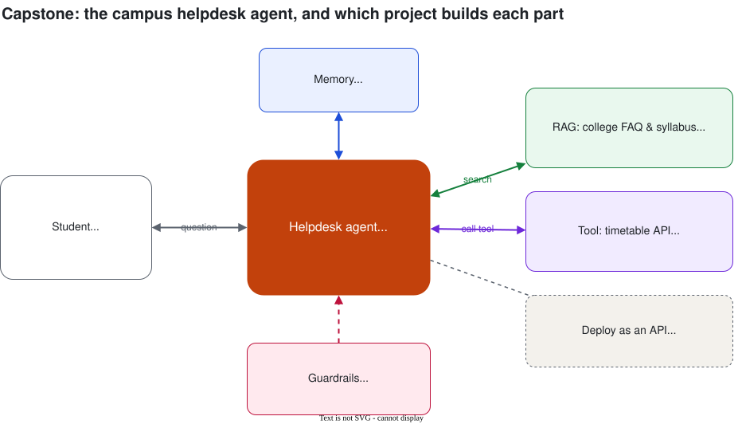

# Projects

Six small projects, one per lab. Each adds a piece, and together they become a **campus helpdesk agent** you can put on your GitHub and resume.

**Web version:** [projects/index.html](index.html)

*Diagram source: [diagrams/helpdesk-architecture.drawio](diagrams/helpdesk-architecture.drawio)*

| # | Project | Session | Level | Status |
| --- | --- | --- | --- | --- |
| 1 | [Prompt Lab](#project-1--prompt-lab) | 2. Prompt engineering | Beginner | **Starter ready** |
| 2 | [Chatbot with memory](#project-2--chatbot-with-memory) | 3. LLM APIs | Beginner | **Starter ready** |
| 3 | [Chat with the syllabus (RAG)](#project-3--chat-with-the-syllabus-rag) | 4. RAG | Intermediate | **Starter ready** |
| 4 | [Timetable agent + MCP server](#project-4--timetable-agent--mcp-server) | 7. Tool calling & MCP | Intermediate | Coming soon |
| 5 | [Research team (multi-agent)](#project-5--research-team-multi-agent) | 8. Agent frameworks | Intermediate | Coming soon |
| 6 | [Campus helpdesk agent](#project-6--campus-helpdesk-agent-capstone) | 10. Mini project | Capstone | Coming soon |

**What you need:** a Google account for Google Colab and a free Gemini API key from Google AI Studio (or a Groq key). No installs, no credit card.

---

## Day 1: Generative AI

### Project 1 · Prompt Lab

*Session 2 · Beginner · 20 min* · 

Take three everyday tasks, write a weak and a strong prompt for each, and compare the answers.

- A fest caption writer (role, audience, tone, length)
- A complaint router that replies with one department name (few-shot)
- An enquiry email → JSON extractor your code can read (structured output)
- Bonus: a "CampusBuddy" system prompt, and try to break it

**Stretch:** test your complaint router on 20 real complaints and count how many it gets right. That's your first evaluation.

Notebook: [labs/session-02-prompt-lab.ipynb](../labs/session-02-prompt-lab.ipynb) · Notes: [Session 2](../session-02/notes.md#9-lab-weak-vs-strong-prompts-20-min)

### Project 2 · Chatbot with memory

*Session 3 · Beginner · 25 min* · 

Call an LLM from Python and build "CampusBuddy", a chatbot that remembers the conversation. "Memory" is just re-sending the chat history each time.

- Make your first API call and print the token usage
- Write a `cost()` function and stream an answer
- Keep a `history` list and send it with every request; break it, then fix it
- A chat loop that shows tokens and cost after every turn

**Stretch:** keep only the last 6 messages, retry on rate limits, or switch the bot to Groq.

Notebook: [labs/session-03-chatbot-lab.ipynb](../labs/session-03-chatbot-lab.ipynb) · Notes: [Session 3](../session-03/notes.md#10-lab-chatbot-with-memory-25-min)

### Project 3 · Chat with the syllabus (RAG)

*Session 4 · Intermediate · 45 min* · 

Make the chatbot answer from college documents, with citations, instead of guessing. The starter uses a [sample FAQ](../labs/data/abc-college-faq.md) for a fictional college; then you swap in your own college's PDF.

- Load the FAQ → chunk it by section → embed the chunks
- Search by meaning with NumPy, then store everything in Chroma
- Answer with the source in [brackets], and refuse questions that aren't in the documents
- Measure the retrieval hit rate on a small test set

**Stretch:** upload your own college PDF, tune chunk size, k and the minimum score, or add memory from Project 2.

Notebook: [labs/session-04-rag-lab.ipynb](../labs/session-04-rag-lab.ipynb) · Notes: [Session 4](../session-04/notes.md#12-lab-chat-with-the-college-faq-45-min)

---

## Day 2: Agentic AI

### Project 4 · Timetable agent + MCP server

*Session 7 · Intermediate · 45 min · Coming soon*

Give the LLM a tool. The agent decides when to call `get_exam_date(subject)` or a weather API, reads the result, and answers.

- Define a tool with a name, description and parameters
- Run the tool-calling loop: model asks → your code runs the tool → model answers
- Expose the same tool as an **MCP server** so any MCP client can use it

**Stretch:** add a second tool (library hours) and see the agent pick the right one.

### Project 5 · Research team (multi-agent)

*Session 8 · Intermediate · 45 min · Coming soon*

A **researcher** agent collects facts on a topic and a **writer** agent turns them into a short report.

- Build it with an agent framework (LangGraph or CrewAI)
- Pass work from one agent to the next
- Add a human approval step before the final report

**Stretch:** add a "reviewer" agent that checks the report for mistakes.

---

## Project 6 · Campus helpdesk agent (capstone)

*Session 10 · Capstone · 60 min · Coming soon*

A student asks *"When is my DBMS exam, and is the library open on Sunday?"* and the agent answers using everything you built.

| Piece | Comes from |
| --- | --- |
| System prompt with role and rules | Project 1 |
| Conversation memory | Project 2 |
| Answers from the college FAQ, with sources | Project 3 |
| Timetable tool over MCP | Project 4 |
| Guardrails: "I don't know", no personal data | Session 5 |
| Deployed as an API (stretch) | Session 9 |

**Make it portfolio-ready:** push it to GitHub with a README that has a screenshot, a diagram, how to run it, 5 example questions it answers well and 2 it refuses correctly. Deploy it and add the link to your resume.

---

## More project ideas for your portfolio

| Idea | Uses |
| --- | --- |
| Resume reviewer that scores a resume against a job description | Prompting, JSON output |
| Previous-year question paper bot ("all DBMS questions on normalisation") | RAG |
| Kannada / Hindi / Tamil FAQ bot for the college office | RAG, multilingual models |
| Interview practice agent that asks questions and gives feedback | System prompts, memory |
| Expense tracker that reads bill photos and fills a Google Sheet | Vision model, tools |
| GitHub repo explainer ("how does this project work?") | RAG over code, agents |
