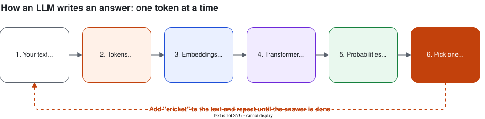

# Session 1: How LLMs Work

**Day 1 · Session 1 · 1 hour** · [Slides](slides.html) · [Web version of these notes](notes.html)

What happens inside ChatGPT, Gemini or Claude when you type a question? This session explains it in plain language. No heavy math.

## Contents

0. [Introduction: why this workshop, why now](#0-introduction-why-this-workshop-why-now)
1. [The big picture](#1-the-big-picture)
2. [Transformers and attention](#2-transformers-and-attention)
3. [An LLM is a next-word predictor](#3-an-llm-is-a-next-word-predictor)
4. [Tokens](#4-tokens)
5. [Embeddings](#5-embeddings)
6. [Context window](#6-context-window)
7. [Temperature](#7-temperature)
8. [Why LLMs hallucinate](#8-why-llms-hallucinate)
9. [Open vs closed models, and how to choose](#9-open-vs-closed-models-and-how-to-choose)
10. [Recap, quiz and glossary](#10-recap)

---

## 0. Introduction: why this workshop, why now

You have probably seen the headlines: layoffs, slow fresher hiring, and "AI will replace programmers" posts everywhere. Let's be honest about what is happening and what you can do about it.

### Why are there layoffs?

1. **Correction after over-hiring.** Companies hired very fast in 2020–22 and cut back when demand cooled.
2. **Cost pressure.** Clients cut "nice to have" projects first. Indian IT services feel this directly.
3. **Money is moving to AI.** GPUs, data centres and AI teams. Other teams shrink to pay for it.
4. **Routine tasks are being automated.** Boilerplate code, simple tests, basic support tickets. Often entry-level work.
5. **Flatter teams.** Fewer management layers, smaller teams expected to do more with AI.

> **The real picture:** AI mostly replaces **tasks**, not whole jobs. The work is changing shape. A developer who uses AI well can do what used to take a small team, and companies are hiring for *that* person.

**Example: the same task, two ways.** Before, a fresher spent two days writing CRUD APIs and tests. Now an AI assistant writes the first draft in minutes. The valuable work is everything around it: understanding the need, designing the data model, reviewing the code, deploying it.

### What to improve

| Skill | Why it matters more now |
| --- | --- |
| **Fundamentals**: DSA, OOP, DBMS/SQL, networking, OS | You can't judge AI-written code without understanding it yourself. |
| **Problem solving and system design** | AI writes functions. Deciding *what* to build is still your job. |
| **Reading and reviewing code** | Spotting bugs in AI output is a core skill. |
| **Communication** | Prompting is communication. So are requirements, docs and interviews. |
| **Ownership** | A deployed project beats ten unfinished tutorials. |
| **Domain knowledge** | AI is generic. Knowing a business problem deeply is what makes your solution useful. |

### What to learn

1. **Foundations:** Python, Git and GitHub, SQL, REST APIs and JSON, basic Linux.
2. **Use AI tools daily:** chat and coding assistants. Learn where they help and where they fail.
3. **Build with LLMs:** prompting, LLM APIs, RAG. *(Day 1)*
4. **Build agents:** tool calling, MCP, agent frameworks. *(Day 2)*
5. **Take it to production:** cloud, Docker, evaluation, monitoring, cost, security.

> **Your goal for these two days:** leave with one working AI project on your GitHub: a campus helpdesk agent you built yourself.

---

## 1. The big picture

Each term sits inside the one before it:

- **Artificial Intelligence (AI):** any machine that does something "smart", including old rule-based systems.
  - **Machine Learning (ML):** learns patterns from examples instead of being given rules.
    - **Deep Learning (DL):** ML with large neural networks that have many layers.
      - **Generative AI and LLMs:** models that create new text, images, code or audio.

### Traditional programming vs machine learning

| | Traditional programming | Machine learning |
| --- | --- | --- |
| You give it | Rules + data | Data + correct answers (examples) |
| It gives you | Answers | The rules (a "model") |
| Spam filter | `if "lottery" in email: spam`. Breaks on "l0ttery". | Learns from 10,000 labelled emails, including patterns you never thought of. |

**Example: placement prediction.** Give an ML model past student records (CGPA, internships, projects) and whether each was placed. It learns which factors matter and predicts the chance for a new student.

### Deep learning

A **neural network** is layers of simple maths units. "Deep" means many layers. In **face unlock**, early layers spot edges, middle layers spot eyes and nose, the last layer recognises *your* face. Nobody programmed "what an eye looks like".

---

## 2. Transformers and attention

In 2017, Google researchers published *"Attention Is All You Need"*, introducing the **transformer**. The "T" in GPT stands for Transformer.

Older models read one word at a time and forgot the start of long sentences. A transformer looks at **all the words at once** and works out **which words matter for each other**. This is **attention**.

**Example: "bank"**
- "I went to the **bank** to deposit my scholarship money." → financial bank
- "We sat on the river **bank** and watched the sunset." → side of a river

**Example: "it"**
- "The dog didn't cross the road because **it** was too tired." → it = the dog
- "The dog didn't cross the road because **it** was too busy." → it = the road

---

## 3. An LLM is a next-word predictor

A **Large Language Model** is a huge transformer trained on a huge amount of text to do one job: **predict the next word** (token).

**Example:** "Virat Kohli is famous for playing ___" → **cricket** 92%, *for* 3%, *in* 2%... It picks one, adds it to the text, and predicts again.



*Diagram source: [diagrams/llm-pipeline.drawio](diagrams/llm-pipeline.drawio)*

> **Key idea:** an LLM does not look up answers. It generates the most likely continuation, one token at a time.

**"Large"** refers to the number of **parameters**: the numbers inside the network that store what it learned. Modern LLMs have billions.

### From predictor to helpful assistant

1. **Pre-training:** read a huge part of the internet, learn to predict the next word. *(Reading a whole library.)*
2. **Instruction tuning:** learn from question → good answer examples. *(Practising exam answers.)*
3. **Human feedback (RLHF):** humans rank answers; the model learns to be helpful and safe. *(A mentor's feedback.)*

---

## 4. Tokens

LLMs read **tokens**: small chunks of text. "I love unbelievable biryani!" might become:

`I` · ` love` · ` un` · `believ` · `able` · ` bir` · `yani` · `!`

> **Rule of thumb (English):** 1 token ≈ 4 characters ≈ ¾ of a word. 100 tokens ≈ 75 words.

**Why tokens matter**
- **Cost:** APIs charge per token, input and output.
- **Limits:** each model has a maximum number of tokens.
- **Indian languages cost more:** Hindi, Kannada or Tamil often take several times more tokens than English.
- **Strange mistakes:** "How many r's in *strawberry*?" Older models said 2. They see `str` `aw` `berry`, not letters.

**Try it:** paste a sentence into the [OpenAI Tokenizer](https://platform.openai.com/tokenizer) or [Tiktokenizer](https://tiktokenizer.vercel.app), in English and in Hindi.

```python
# Count tokens (Google Colab)
!pip install tiktoken
import tiktoken

enc = tiktoken.get_encoding("cl100k_base")
tokens = enc.encode("I love unbelievable biryani!")
print(len(tokens), "tokens")
print([enc.decode([t]) for t in tokens])
```

---

## 5. Embeddings

An **embedding** turns text into a list of numbers (a **vector**) so that **similar meanings end up close together**. Food words cluster together, job words cluster together, cricket words cluster together.

**Example: search by meaning.** Student asks *"How do I apply for placements?"*

| Sentence in the FAQ | Similarity (illustrative) |
| --- | --- |
| What is the process for campus recruitment? | 0.82 (very close) |
| Steps to register with the training & placement cell | 0.78 |
| Placement of furniture in the new hostel block | 0.21 (far) |

The first shares almost no words with the question but means the same thing. Keyword search would get this backwards.

> **Famous example:** king − man + woman ≈ queen.

Used for semantic search, recommendations, duplicate detection and **RAG** (Session 4).

```python
# Compare sentence meanings (Google Colab)
!pip install sentence-transformers
from sentence_transformers import SentenceTransformer, util

model = SentenceTransformer("all-MiniLM-L6-v2")
q = "How do I apply for placements?"
faqs = ["What is the process for campus recruitment?",
        "Placement of furniture in the new hostel block"]

scores = util.cos_sim(model.encode(q), model.encode(faqs))
for faq, s in zip(faqs, scores[0]):
    print(f"{s:.2f}  {faq}")
```

---

## 6. Context window

The **context window** is the maximum number of tokens a model can see at once: instructions + conversation + documents + the answer.

> **Analogy:** an open-book exam with a small desk. Add more pages and the oldest ones fall off.

- Sizes range from a few thousand to hundreds of thousands (even a million) tokens.
- Long chats get old messages dropped or summarised, so the bot "forgets".
- **LLMs have no memory between calls.** Apps re-send the whole conversation every time (Session 3).
- Bigger isn't free: more tokens = more cost and slower answers.

---

## 7. Temperature

**Temperature** controls how the model picks from its list of likely next tokens.

| Task | Temperature | Why |
| --- | --- | --- |
| Answer from the syllabus, extract JSON, write code | Low (0 – 0.3) | Same correct answer every time |
| General chat, explanations | Medium (0.5 – 0.8) | Natural but focused |
| Tech fest names, poems, brainstorming | High (0.9 – 1.2) | Variety and surprise |

Related setting: **top-p**. Usually tune one of the two, not both.

---

## 8. Why LLMs hallucinate

A **hallucination** is a confident, fluent answer that is **false or made up**.

**Example:** "Summarise the 2019 paper *'Quantum Biryani Optimization'* by Dr. R. Sharma, IIT Bombay." The paper doesn't exist, but a model may still write a detailed summary.

**Why it happens**
1. It predicts **plausible** text, not **true** text.
2. It has no built-in fact database.
3. It has a **knowledge cutoff**.
4. Training rewards answering more than saying "I don't know".

**How to reduce it**
- Give it the source (paste it, or use **RAG**, Session 4).
- Say "If the answer isn't in the text, say you don't know."
- Ask for citations, then check them.
- Lower the temperature for factual tasks.
- Give it tools like search or a calculator (Day 2).
- Keep a human in the loop for anything important.

---

## 9. Open vs closed models, and how to choose

| | Closed models | Open-weight models |
| --- | --- | --- |
| Examples | **GPT** (OpenAI), **Claude** (Anthropic), **Gemini** (Google) | **Llama** (Meta), **Mistral**, Gemma, Qwen, DeepSeek |
| How you use it | Through the company's app or API | Download and run it yourself (Ollama, own server, Groq) |
| Strengths | Usually most capable, no hardware, quick start | Control, privacy, customisable, no per-token fee if self-hosted |
| Weaknesses | Pay per token, data goes to provider | Need GPUs and skills, licences vary |

### How to choose: a checklist

1. **Quality:** good enough at *your* task? Test with 10–20 real examples.
2. **Cost:** requests per day × tokens per request × price.
3. **Speed:** live chat or overnight job?
4. **Privacy:** can the data leave your organisation?
5. **Language:** Hindi, Kannada, Tamil?
6. **Context length:** long documents?
7. **Licence:** commercial use allowed?

**Scenarios**
- *24-hour hackathon prototype* → closed API or free tier.
- *Hospital records that can't leave the building* → open-weight, self-hosted.
- *Classify 10 lakh reviews a day* → a small, cheap, fast model.
- *Support chatbot in Kannada* → test several models on real Kannada questions.

> **Tip:** start with the strongest model to prove the idea, then try cheaper ones and keep the smallest that's still good enough.

---

## 10. Recap

1. AI ⊃ ML ⊃ Deep Learning ⊃ LLMs. ML learns rules from examples.
2. Transformers use **attention** to understand each word in context.
3. An LLM **predicts the next token**, again and again.
4. **Tokens** = cost and limits. **Embeddings** = meaning as numbers.
5. The **context window** is short-term memory. LLMs don't remember between calls.
6. **Temperature**: low for facts, high for creativity.
7. LLMs **hallucinate**. Ground them with sources.
8. Choose models by quality, cost, speed, privacy, language and licence.

## Quick quiz

<details><summary>1. An ML spam filter is given 10,000 labelled emails. What does it produce?</summary>A model: patterns it learned to decide whether a new email is spam.</details>
<details><summary>2. What does "attention" help a transformer do?</summary>Decide which other words matter for understanding each word.</details>
<details><summary>3. Roughly how many tokens is a 750-word English essay?</summary>About 1,000 tokens.</details>
<details><summary>4. Why does a chatbot "forget" the start of a long conversation?</summary>The conversation exceeded the context window.</details>
<details><summary>5. Extracting names and marks into JSON: high or low temperature?</summary>Low (around 0).</details>
<details><summary>6. Two reasons LLMs hallucinate, and one fix?</summary>They predict plausible text; they have a knowledge cutoff; training rewards answering. Fix: give sources (RAG), allow "I don't know", lower temperature.</details>
<details><summary>7. A bank's data can't leave its servers. Open or closed model?</summary>An open-weight model on the bank's own infrastructure.</details>

## Glossary

| Term | Meaning in one line |
| --- | --- |
| Model | The trained program that makes predictions. |
| Parameters | The numbers inside a model that store what it learned. |
| Neural network | Layers of simple maths units that learn patterns. |
| Transformer | The network design behind LLMs; uses attention. |
| Token | A chunk of text the model reads and writes. |
| Embedding | A list of numbers representing meaning. |
| Context window | Max tokens the model can see at once. |
| Temperature | How random or creative the word choice is. |
| Hallucination | A confident but false answer. |
| Knowledge cutoff | The date after which the model has no training data. |
| RLHF | Reinforcement Learning from Human Feedback. |
| Open-weight model | A model whose parameters you can download and run. |

## Learn more (free)

- 3Blue1Brown, *Neural Networks* video series (YouTube)
- Andrej Karpathy, *Intro to Large Language Models* (YouTube)
- Jay Alammar, *The Illustrated Transformer*
- Vaswani et al., *Attention Is All You Need* (2017)

---

**Next:** [Session 2: Prompt Engineering](../session-02/notes.md)
