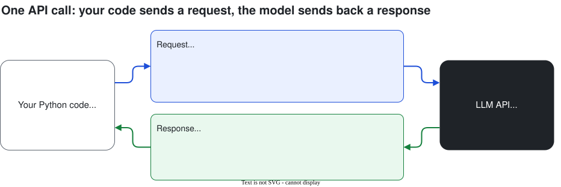
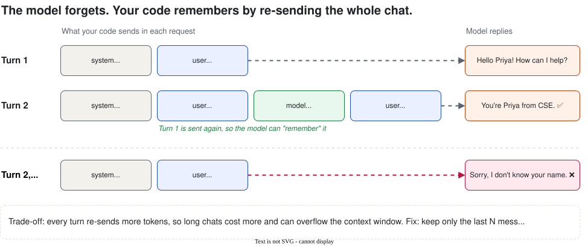
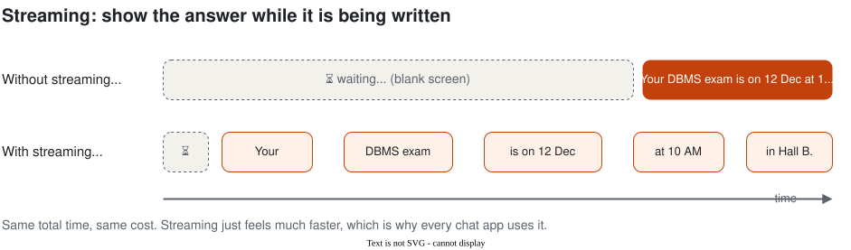

# Session 3: Building with LLM APIs

**Day 1 · Session 3 · 1 hour** · [Slides](slides.html) · [Web version of these notes](notes.html) · [Lab notebook](../labs/session-03-chatbot-lab.ipynb)

So far we've used chat apps. Now we call the model from our own Python code, so we can build our own apps. By the end you'll have a working chatbot that remembers the conversation.

## Contents

1. [What is an API?](#1-what-is-an-api)
2. [Your API key, and keeping it secret](#2-your-api-key-and-keeping-it-secret)
3. [Your first API call](#3-your-first-api-call)
4. [Messages and roles](#4-messages-and-roles)
5. [Chat memory](#5-chat-memory-the-model-forgets-your-code-remembers)
6. [Streaming](#6-streaming)
7. [Tokens and cost](#7-tokens-and-cost)
8. [Errors and rate limits](#8-errors-and-rate-limits)
9. [Other providers look the same](#9-other-providers-look-the-same)
10. [Lab: chatbot with memory](#10-lab-chatbot-with-memory-25-min)
11. [Recap, quiz and glossary](#11-recap)

---

## 1. What is an API?

An **API** (Application Programming Interface) is a way for one program to ask another program to do something. You send a **request**, you get back a **response**.

> **Analogy: ordering food.** You (your code) don't go into the kitchen (the model). You give your order to the waiter (the API), and the waiter brings back your food (the answer).

| | Chat app (ChatGPT, Gemini) | API |
| --- | --- | --- |
| Who uses it | A person, typing | Your program |
| What you can build | Nothing; you just chat | Your own apps: bots, tools, automations |
| Memory | Built in | You build it yourself (section 5) |
| Cost | Free or monthly plan | Pay per token (free tiers exist) |



---

## 2. Your API key, and keeping it secret

An **API key** is a secret string that proves the request is from you. Whoever has your key can use your account and your quota.

1. Get a free Gemini key at [Google AI Studio](https://aistudio.google.com/apikey) (no credit card), or a Groq key at console.groq.com.
2. In Google Colab, click the 🔑 **Secrets** icon, add a secret named `GEMINI_API_KEY`, paste the key and switch on *Notebook access*.
3. Read it in code with `userdata.get("GEMINI_API_KEY")`.

> **Never do this:** `api_key = "AIzaSy..."` written in your code and pushed to GitHub. Bots scan public repos and find leaked keys within minutes. Keep keys in Colab Secrets, or in a `.env` file listed in `.gitignore`. If a key leaks, delete it and make a new one.

---

## 3. Your first API call

```python
!pip install -q google-genai
from google import genai
from google.colab import userdata

client = genai.Client(api_key=userdata.get("GEMINI_API_KEY"))
MODEL = "gemini-2.5-flash"   # any current free model from Google AI Studio

resp = client.models.generate_content(
    model=MODEL,
    contents="Explain what a compiler does in 2 lines, for a first-year student.",
)
print(resp.text)
```

That's it: **a client, a model name, and your text**.

### Adding settings

```python
from google.genai import types

resp = client.models.generate_content(
    model=MODEL,
    contents="Suggest 3 names for our college coding club.",
    config=types.GenerateContentConfig(
        system_instruction="You are a creative assistant. Reply as a numbered list.",
        temperature=1.0,          # creative task, so higher
        max_output_tokens=200,    # stop after ~150 words
    ),
)
print(resp.text)
```

**What's in the response?**
- `resp.text`: the answer
- `resp.usage_metadata`: tokens in and out (this is what you pay for)
- `resp.candidates[0].finish_reason`: `STOP` = finished normally; `MAX_TOKENS` = cut off

---

## 4. Messages and roles

| Role | Who | Example |
| --- | --- | --- |
| **system** | You, the developer (hidden rules) | "You are CampusBuddy. Answer only college questions." |
| **user** | The person chatting | "When is the DBMS exam?" |
| **model** / **assistant** | The AI's earlier replies | "DBMS is on 12 Dec at 10 AM." |

Gemini calls the AI's role `model` and passes the system prompt in the config. OpenAI-style APIs (Groq, OpenAI) call it `assistant` and put the system prompt as the first message. Same idea, different names.

---

## 5. Chat memory: the model forgets, your code remembers

**LLMs have no memory between calls** (Session 1). Chat apps remember because they **re-send the whole conversation** every time.



In code, memory is just a Python list that grows:

```python
SYSTEM = "You are CampusBuddy, a friendly helpdesk bot for ABC Engineering College."
history = []   # the whole conversation lives here

def chat(user_text):
    history.append({"role": "user", "parts": [{"text": user_text}]})
    resp = client.models.generate_content(
        model=MODEL,
        contents=history,                       # send EVERYTHING so far
        config=types.GenerateContentConfig(system_instruction=SYSTEM),
    )
    history.append({"role": "model", "parts": [{"text": resp.text}]})
    return resp.text

print(chat("Hi, I'm Priya from CSE."))
print(chat("What's my name and branch?"))   # → Priya, CSE
```

> **Try it: break the memory.** Change `contents=history` to `contents=user_text` and ask "What's my name?" again. The bot forgets. That one line *is* the memory.

### The catch: long chats get expensive

Every turn re-sends all earlier turns, so the input grows. Two simple fixes:
- **Keep only the last N messages:** `contents=history[-10:]`
- **Summarise old messages** and send the summary instead.

The SDK also has `client.chats.create(...)`, which keeps the history for you. We build it by hand first so you know what's happening inside.

---

## 6. Streaming

Without streaming, the user stares at a blank screen and then everything appears at once. With **streaming**, words appear as the model writes them.



```python
for chunk in client.models.generate_content_stream(
    model=MODEL,
    contents="Give 5 tips to prepare for campus placements.",
):
    print(chunk.text or "", end="", flush=True)
```

Same cost, same total time. It just **feels** much faster.

---

## 7. Tokens and cost

APIs charge per token, with separate prices for **input** (what you send) and **output** (what the model writes). Output usually costs several times more.

```python
u = resp.usage_metadata
print("Input tokens: ", u.prompt_token_count)
print("Output tokens:", u.candidates_token_count)
print("Total:        ", u.total_token_count)
```

**Example: what would a campus chatbot cost?** Illustrative prices: **$0.30 per million input tokens**, **$2.50 per million output tokens**. Always check the current pricing page.

| | Calculation | Tokens per day | Cost per day |
| --- | --- | --- | --- |
| Input | 2,000 students × 10 questions × 500 tokens | 10 million | $3.00 |
| Output | 2,000 students × 10 questions × 200 tokens | 4 million | $10.00 |
| **Total** | | | **$13 a day (roughly ₹1,100)** |

The 500 input tokens include the system prompt and chat history, which are re-sent every turn.

```python
PRICE_IN, PRICE_OUT = 0.30, 2.50   # $ per million tokens (check current prices)

def cost(resp):
    u = resp.usage_metadata
    return (u.prompt_token_count * PRICE_IN + (u.candidates_token_count or 0) * PRICE_OUT) / 1_000_000

print(f"This answer cost ${cost(resp):.6f}")
```

**How to keep costs down**
- Use the **smallest model** that's good enough.
- Keep the **system prompt short**; it's sent every turn.
- **Trim the history**.
- Set `max_output_tokens` and ask for short answers.
- **Cache** answers to common questions.

Some newer models also "think" before answering. Thinking tokens are billed as output, so a reasoning model can cost more for the same visible answer.

---

## 8. Errors and rate limits

| Error | What it means | What to do |
| --- | --- | --- |
| **400** Bad request | Something wrong in your request | Fix your code |
| **401 / 403** | Key missing, wrong or not allowed | Check the key and secret name |
| **429** Too many requests | You hit the **rate limit** or daily quota | Wait and retry; slow down |
| **500 / 503** | Problem on the provider's side | Wait and retry |

```python
import time
from google.genai import errors

def ask_with_retry(prompt, tries=3):
    for i in range(tries):
        try:
            return client.models.generate_content(model=MODEL, contents=prompt).text
        except errors.APIError as e:
            if e.code in (429, 500, 503) and i < tries - 1:
                wait = 5 * 2 ** i          # 5s, then 10s, then 20s
                print(f"Error {e.code}, retrying in {wait}s...")
                time.sleep(wait)
            else:
                raise
```

Waiting longer after each failure is called **exponential backoff**. In a class of 60 students on free keys, some 429s are normal.

---

## 9. Other providers look the same

Every LLM API follows the same pattern: **model + messages + settings → text + token usage**. Here is the same call on **Groq**, which uses the OpenAI-style format:

```python
!pip install -q groq
from groq import Groq

groq = Groq(api_key=userdata.get("GROQ_API_KEY"))
resp = groq.chat.completions.create(
    model="llama-3.3-70b-versatile",   # check console.groq.com for current models
    messages=[
        {"role": "system", "content": "You are CampusBuddy."},
        {"role": "user", "content": "Explain what a compiler does in 2 lines."},
    ],
)
print(resp.choices[0].message.content)
print(resp.usage.prompt_tokens, resp.usage.completion_tokens)
```

Handy as a **backup** if one provider is down or rate-limited during the workshop.

---

## 10. Lab: chatbot with memory (25 min)

Build **CampusBuddy**, a chatbot that remembers the conversation, streams its answers and tells you what each turn cost.

[](https://colab.research.google.com/github/Amitpnk/Agentic-AI-From-Zero/blob/main/labs/session-03-chatbot-lab.ipynb)

1. Make your first call and print the token usage.
2. Write a `cost()` function.
3. Stream an answer.
4. Build `chat()` with a `history` list. Prove it remembers your name.
5. Break the memory on purpose, then fix it.
6. Run a chat loop: type questions, `quit` to stop. Print tokens and cost after each turn.

**Stretch:** keep only the last 6 messages and watch input tokens stop growing · add retry for 429 · switch the bot to Groq.

This is **[Project 2](../projects/README.md#project-2--chatbot-with-memory)** in the workshop project list.

---

## 11. Recap

1. An **API** lets your code send a request to a model and get a response.
2. Your **API key** is a password. Keep it in Secrets or `.env`, never in GitHub.
3. A call needs a **model** and **contents**. Settings add a system prompt, temperature and max tokens.
4. Messages have **roles**: system, user, model/assistant.
5. **Memory** = your code re-sends the whole history. Trim it to save cost.
6. **Streaming** shows words as they're written. Same cost, feels faster.
7. **Cost** = input tokens × input price + output tokens × output price.
8. Handle **429** and **5xx** errors with retry and backoff.

## Quick quiz

<details><summary>1. What three things does the simplest API call need?</summary>A client with your API key, a model name, and the contents (your text).</details>
<details><summary>2. A friend pushed their API key to a public GitHub repo. What should they do?</summary>Revoke the key immediately, create a new one, and store it in Secrets or a <code>.env</code> file listed in <code>.gitignore</code>.</details>
<details><summary>3. How does a chatbot "remember" your name if the model has no memory?</summary>The app keeps the conversation in a list and sends the whole list with every request.</details>
<details><summary>4. Why do long chats cost more per question?</summary>Every turn re-sends all earlier messages as input tokens.</details>
<details><summary>5. Does streaming make the answer cheaper?</summary>No. Same tokens, same cost. It just shows words sooner.</details>
<details><summary>6. You get error 429. What does it mean?</summary>Too many requests: rate limit or quota hit. Wait and retry with backoff.</details>
<details><summary>7. 1,000 users × 5 questions × 400 input tokens a day, at $0.30 per million input tokens. Input cost per day?</summary>2,000,000 × $0.30 / 1,000,000 = $0.60 a day.</details>

## Glossary

| Term | Meaning in one line |
| --- | --- |
| API | A way for your program to ask another program to do something. |
| API key | A secret string that proves a request is from you. |
| SDK | A library (like `google-genai`) that makes calling an API easy. |
| Request / response | What you send / what you get back. |
| Role | Who wrote a message: system, user or model/assistant. |
| Chat history | The list of earlier messages your code re-sends for memory. |
| Streaming | Receiving the answer piece by piece as it's written. |
| Input / output tokens | Tokens you send / tokens the model writes. Both are billed. |
| Rate limit | Maximum requests allowed per minute or day. |
| Exponential backoff | Retrying after waiting longer each time (5s, 10s, 20s...). |

## Learn more (free)

- Google, *Gemini API quickstart* and *Text generation* guides (ai.google.dev)
- Groq, *Quickstart* (console.groq.com/docs)
- OpenAI and Anthropic API docs: same concepts, different SDKs

## Instructor guide

| Time | Segment | What to do |
| --- | --- | --- |
| 0–5 min | Hook | How would you put ChatGPT inside your own app? Waiter analogy, request/response diagram. |
| 5–12 min | API key + first call | Everyone adds a Gemini key to Colab Secrets. Live-code the first call. Warn about keys on GitHub. |
| 12–22 min | Roles + memory | Memory diagram. Live: chat() remembers "Priya", then break it. |
| 22–30 min | Streaming + cost | Stream a long answer. Print usage. 2,000-students cost example on the board. |
| 30–33 min | Errors | Error table. 429s in class are normal. |
| 33–55 min | Lab | Students build the chatbot. Most issues: secret name or Notebook access off. |
| 55–60 min | Recap + quiz | Quiz questions 3, 4 and 7. Preview Session 4: RAG. |

**Before class:** check the current free model name in Google AI Studio and update `MODEL` in the notebook if needed. Have a Groq key as backup. In a large class, stagger the first run to avoid rate limits.

*Diagram sources: [api-call.drawio](diagrams/api-call.drawio) · [chat-memory.drawio](diagrams/chat-memory.drawio) · [streaming.drawio](diagrams/streaming.drawio)*

---

**Previous:** [Session 2: Prompt Engineering](../session-02/notes.md) · **Next:** [Session 4: RAG](../session-04/notes.md)
