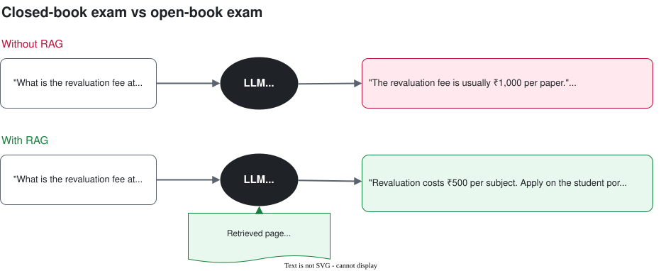
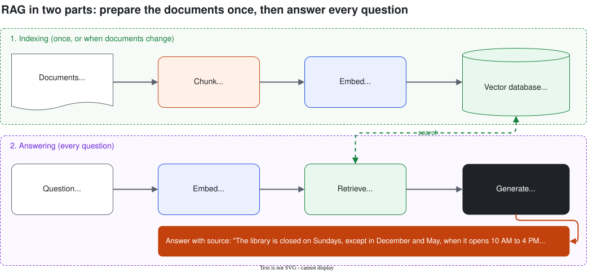
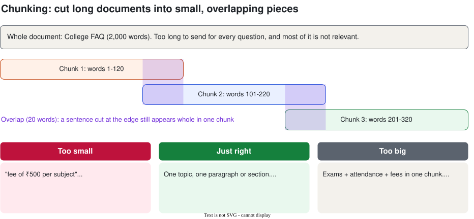

# Session 4: RAG (Retrieval-Augmented Generation)

**Day 1 · Session 4 · 2 hours** · [Slides](slides.html) · [Web version of these notes](notes.html) · [Lab notebook](../labs/session-04-rag-lab.ipynb) · [Sample FAQ](../labs/data/abc-college-faq.md)

An LLM doesn't know your college's rules, timetable or syllabus. RAG fixes that: before answering, it looks up the right page in your documents and answers from it, with the source.

## Contents

1. [The problem](#1-the-problem-the-model-doesnt-know-your-documents)
2. [What RAG is](#2-what-rag-is-an-open-book-exam)
3. [The RAG pipeline in six steps](#3-the-rag-pipeline-in-six-steps)
4. [Step 1: Load](#4-step-1-load)
5. [Step 2: Chunk](#5-step-2-chunk)
6. [Step 3: Embed](#6-step-3-embed)
7. [Step 4: Store in a vector database](#7-step-4-store-in-a-vector-database)
8. [Step 5: Retrieve](#8-step-5-retrieve)
9. [Step 6: Generate with citations](#9-step-6-generate-with-citations)
10. [When RAG goes wrong](#10-when-rag-goes-wrong-and-how-to-fix-it)
11. [How to test a RAG bot](#11-how-to-test-a-rag-bot)
12. [Lab](#12-lab-chat-with-the-college-faq-45-min)
13. [Recap, quiz and glossary](#13-recap)

---

## 1. The problem: the model doesn't know your documents

Ask any chatbot *"What is the revaluation fee at our college?"* and it can't know. Your college's rules were never in its training data. So it says "I don't know" or, worse, **makes something up** (Session 1: hallucination).



| Option | How | Problem |
| --- | --- | --- |
| **Paste everything** | Put the whole document in every prompt | Fine for 2 pages. For 500 pages: too many tokens, slow, expensive, may not fit. |
| **Fine-tune** | Train the model further on your documents | Costly, needs skills, redo on every rule change. Still can hallucinate. |
| **RAG** ✅ | Search your documents, send only the relevant pieces | Needs some setup: this session. |

---

## 2. What RAG is: an open-book exam

**RAG** = **Retrieval-Augmented Generation**:
- **Retrieval:** find the pieces of your documents that match the question.
- **Augmented:** add those pieces to the prompt.
- **Generation:** the LLM writes the answer using them.

> **Analogy:** without RAG, the model writes a closed-book exam from memory. With RAG, it flips to the right page of the textbook first, answers from it, and can tell you *which page*.

---

## 3. The RAG pipeline in six steps

**Indexing** prepares your documents once (and again when they change). **Answering** runs for every question.



1. **Load:** read PDFs, web pages, docs into text
2. **Chunk:** cut into small pieces
3. **Embed:** turn each piece into a vector
4. **Store:** save in a vector database
5. **Retrieve:** find the pieces closest to the question
6. **Generate:** the LLM answers from those pieces, with sources

---

## 4. Step 1: Load

```python
from pypdf import PdfReader

reader = PdfReader("syllabus.pdf")
pages = [page.extract_text() for page in reader.pages]
print(len(pages), "pages")
print(pages[0][:300])
```

> **Garbage in, garbage out.** Check the extracted text. Tables often come out jumbled, headers repeat on every page, and **scanned PDFs** give no text at all; they need OCR first.

---

## 5. Step 2: Chunk

Cut documents into **chunks**: small pieces, each about one topic. Then send the model only the 2–3 chunks it needs.



- **Chunk size:** start with about **100–300 words** (roughly 150–400 tokens).
- **Overlap:** about **10–20%**, so a sentence cut at the edge still appears whole somewhere.
- **Split on structure** when you can: by heading, section or paragraph.
- **Keep the source** with each chunk (file, page, section) for citations.

```python
def chunk_text(text, size=120, overlap=20):
    words = text.split()
    chunks, step = [], size - overlap
    for start in range(0, len(words), step):
        chunks.append(" ".join(words[start:start + size]))
        if start + size >= len(words):
            break
    return chunks
```

LangChain and LlamaIndex have ready-made "text splitters" that do the same with more options.

---

## 6. Step 3: Embed

Embeddings (Session 1) turn text into numbers so that similar meanings are close together. Embed every chunk once.

```python
from sentence_transformers import SentenceTransformer

embedder = SentenceTransformer("all-MiniLM-L6-v2")   # small, free, runs in Colab
vectors = embedder.encode(chunks, normalize_embeddings=True)
print(vectors.shape)   # (number of chunks, 384)
```

> **One rule you must not break:** use the **same embedding model** for chunks and questions. Different models = different "maps".

Options: free local models (like `all-MiniLM-L6-v2`, or multilingual ones for Indian languages) or API models from Google, OpenAI and others.

---

## 7. Step 4: Store in a vector database

A **vector database** stores each chunk's vector with its text and source, and quickly finds the closest vectors to a question.

| Option | What it is | Good for |
| --- | --- | --- |
| **Chroma** | Simple open-source vector DB inside Python | Learning, prototypes (today) |
| **FAISS** | Fast similarity-search library from Meta | Large collections on your own machine |
| **pgvector** | Vector search inside PostgreSQL | Apps already on Postgres |
| **Managed** | Pinecone, Weaviate, Vertex AI Vector Search, Azure AI Search, Amazon OpenSearch / Bedrock Knowledge Bases | Production |

```python
import chromadb

db = chromadb.Client()
col = db.create_collection("college_faq")
col.add(
    ids=["Library-0", "Exams-0"],
    documents=[library_text, exams_text],
    metadatas=[{"source": "Library"}, {"source": "Exams"}],
    embeddings=embedder.encode([library_text, exams_text], normalize_embeddings=True).tolist(),
)
```

---

## 8. Step 5: Retrieve

Embed the question with the same model and get the **top-k** closest chunks (usually k = 3 to 5).

```python
q_vec = embedder.encode(["Is the library open on Sunday?"], normalize_embeddings=True).tolist()
res = col.query(query_embeddings=q_vec, n_results=3)
print(res["metadatas"][0])   # [{'source': 'Library'}, ...]
```

| Question | Top chunk found |
| --- | --- |
| Is the library open on Sunday? | [Library] "...closed on Sundays, except during exam months..." |
| Can I sit for more drives after a 7 LPA offer? | [Placements] "...one-student-one-job policy..." |
| Who won the IPL in 2020? | Nothing relevant: all similarity scores are low |

Use a **minimum similarity score**: if even the best chunk scores low, the answer probably isn't in your documents.

---

## 9. Step 6: Generate with citations

Build a prompt (Session 2) with **rules**, the **retrieved chunks** labelled with their source, and the **question**.

```python
SYSTEM = """You are CampusBuddy, the helpdesk assistant for ABC Engineering College.
Answer the student's question using ONLY the context below.
- After each fact, cite the source in square brackets, like [Exams].
- If the answer is not in the context, say: "I couldn't find that in the
  college documents. Please contact office@abc.edu."
- Keep the answer under 80 words, in simple English."""

context = "\n\n".join(f"[{h['source']}] {h['text']}" for h in hits)
prompt = f"Context:\n{context}\n\nQuestion: {question}"

resp = client.models.generate_content(
    model=MODEL, contents=prompt,
    config=types.GenerateContentConfig(system_instruction=SYSTEM, temperature=0),
)
```

**Q:** My attendance in DBMS is 70%. Can I still write the exam?
**A:** You need 75% to get a hall ticket [Exams]. With 70%, you can apply for condonation with a medical certificate and a ₹1,000 fee; the principal decides [Attendance].

Citations let anyone **check** the answer. "Only use the context" plus "say you couldn't find it" is your main defence against hallucination.

---

## 10. When RAG goes wrong, and how to fix it

Most RAG bugs are **retrieval** bugs. Always look at the retrieved chunks first.

| Symptom | Likely cause | Fix |
| --- | --- | --- |
| Answer is wrong or vague | Right chunk wasn't retrieved | Print retrieved chunks. Change chunk size, k, splitting. |
| "Not found" but it's in the document | Text didn't load, or threshold too high | Check extracted text. Lower the threshold. |
| Answers questions outside the documents | Prompt doesn't restrict it | "ONLY use the context" + minimum score. |
| Old information | Documents changed, index didn't | Re-index on updates. |
| Exact codes not found (e.g. "CS301") | Embeddings match meaning, not exact words | **Hybrid search**: keyword + vector. |

Going further: **re-ranking**, **query rewriting** and **metadata filters**. You don't need these to start.

---

## 11. How to test a RAG bot

1. Write 10–20 real questions with the section where the answer is.
2. **Test retrieval:** is the right section in the top 3? Count the hit rate.
3. **Test answers:** correct, with the right citation?
4. Include 3–4 questions **not** in the documents. The bot should refuse them.
5. Re-run after every change to chunk size, k, prompt or model.

More on evaluation in Session 9.

---

## 12. Lab: chat with the college FAQ (45 min)

Build CampusBuddy-RAG over a [sample FAQ](../labs/data/abc-college-faq.md) for a fictional college, then try it on your own college's PDF.

[](https://colab.research.google.com/github/Amitpnk/Agentic-AI-From-Zero/blob/main/labs/session-04-rag-lab.ipynb)

1. Ask Gemini about the college with no documents. Watch it guess.
2. Load the FAQ and chunk it (by word count, then by heading).
3. Embed the chunks and search by meaning with NumPy.
4. Store the chunks in Chroma and retrieve the top 3.
5. Generate answers with citations; refuse questions not in the FAQ.
6. Measure the retrieval hit rate on 8 test questions.
7. Chat with it.

**Stretch:** upload your own college PDF · tune chunk size, k and the minimum score · add memory from Session 3.

This is **[Project 3](../projects/README.md#project-3--chat-with-the-syllabus-rag)** in the workshop project list.

---

## 13. Recap

1. LLMs don't know your private or recent documents, so they guess.
2. **RAG** = look up the right pieces, add them to the prompt, then answer.
3. **Indexing** (once): load → chunk → embed → store.
4. **Answering** (every question): embed the question → retrieve top-k → generate.
5. Chunks of ~100–300 words, 10–20% overlap, split by section, keep the source.
6. Same embedding model for chunks and questions.
7. Prompt: "use ONLY the context", cite sources, say when it's not found.
8. Most RAG bugs are retrieval bugs. Test with a question set.

## Quick quiz

<details><summary>1. What do the R, A and G in RAG stand for?</summary>Retrieval, Augmented, Generation.</details>
<details><summary>2. Why not paste the whole 500-page syllabus into every prompt?</summary>Too many tokens: expensive, slow, may not fit the context window, and details get missed.</details>
<details><summary>3. Why do chunks overlap?</summary>So an idea cut at a chunk boundary still appears complete in at least one chunk.</details>
<details><summary>4. Chunks embedded with model A, questions with model B. What happens?</summary>Retrieval breaks: different "maps", meaningless scores.</details>
<details><summary>5. "Not found" for an answer that's in a scanned PDF. Why?</summary>A scan is an image; no text was extracted or indexed. It needs OCR.</details>
<details><summary>6. Your bot gives a wrong answer. What do you check first?</summary>Which chunks were retrieved.</details>
<details><summary>7. Name two things to put in a RAG system prompt.</summary>Use only the context; cite sources; say "not found" if missing; keep answers short.</details>

## Glossary

| Term | Meaning in one line |
| --- | --- |
| RAG | Retrieve relevant document pieces, add them to the prompt, then generate. |
| Indexing | Preparing documents for search: load, chunk, embed, store. |
| Chunk | A small piece of a document, usually one topic. |
| Overlap | Words repeated between neighbouring chunks. |
| Embedding model | The model that turns text into vectors. |
| Vector database | Stores vectors and finds the closest ones fast. |
| Top-k | The k most similar chunks returned for a question. |
| Similarity score | How close two vectors are in meaning. |
| Citation / grounding | Linking each fact to the chunk it came from. |
| Hybrid search | Keyword search combined with vector search. |
| Re-ranking | Re-ordering retrieved chunks with a second model. |
| OCR | Reading text from images or scans. |

## Learn more (free)

- Lewis et al., *Retrieval-Augmented Generation for Knowledge-Intensive NLP Tasks* (2020)
- Chroma documentation, *Getting started* (docs.trychroma.com)
- Sentence Transformers documentation, *Semantic search* (sbert.net)
- LangChain and LlamaIndex RAG tutorials, once you've built one by hand

## Instructor guide

| Time | Segment | What to do |
| --- | --- | --- |
| 0–10 min | Hook | Ask a chatbot about the revaluation fee. It guesses. With/without diagram. |
| 10–20 min | Options + what RAG is | Paste vs fine-tune vs RAG. Open-book analogy. Pipeline diagram. |
| 20–40 min | Load, chunk, embed | Messy PDF extraction. Class picks a chunk size. Embeddings recap. |
| 40–55 min | Store, retrieve, generate | Vector DB options. Live notebook Steps 4–6. Point at citations. |
| 55–65 min | Break | Students run the install cell. |
| 65–75 min | Problems + testing | Symptom table. Evaluation cell. |
| 75–115 min | Lab | Pairs work through the notebook. Fast pairs try a real PDF. |
| 115–120 min | Recap + quiz | Quiz 1, 4 and 6. Preview Day 2: agents. |

**Before class:** run the whole notebook once on Colab (install and model download take 1–2 minutes). Bring 2–3 real college PDFs for the stretch goal, and check they're text PDFs, not scans.

*Diagram sources: [with-without-rag.drawio](diagrams/with-without-rag.drawio) · [rag-pipeline.drawio](diagrams/rag-pipeline.drawio) · [chunking.drawio](diagrams/chunking.drawio)*

---

**Previous:** [Session 3: Building with LLM APIs](../session-03/notes.md) · **Next:** Session 5: Responsible AI (coming soon)
