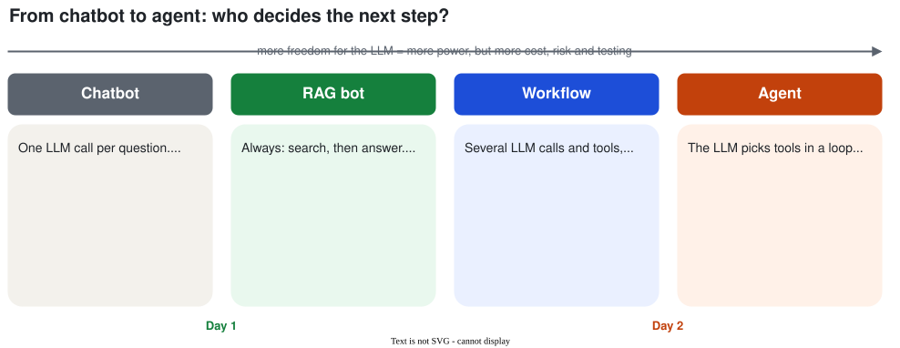
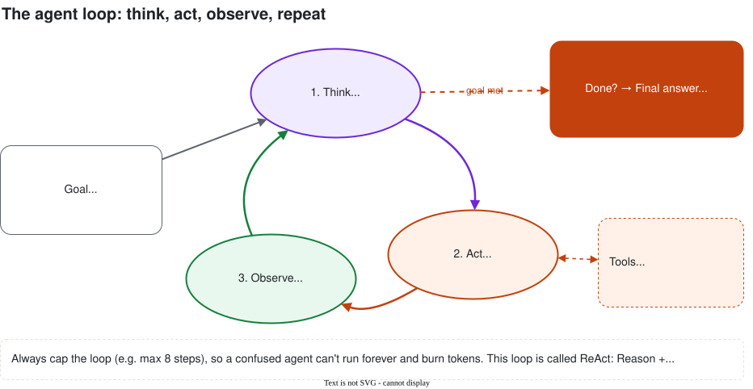
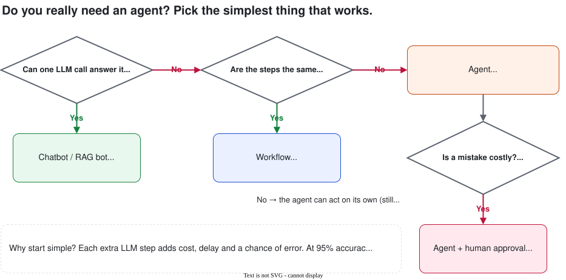

# Session 6: From Chatbots to Agents

**Day 2 · Session 6 · 1 hour** · [Slides](slides.html) · [Web version of these notes](notes.html)

Yesterday's CampusBuddy can *talk*: it answers from documents. Today we make it *do* things: check live data, make bookings, finish multi-step tasks. That's an agent. This session explains what agents are, how they work, and when you **shouldn't** use one.

## Contents

1. [Talking vs doing](#1-talking-vs-doing)
2. [From chatbot to agent: a spectrum](#2-from-chatbot-to-agent-a-spectrum)
3. [What makes an agent: four parts](#3-what-makes-an-agent-four-parts)
4. [The agent loop (ReAct), step by step](#4-the-agent-loop-react-step-by-step)
5. [Tools](#5-tools)
6. [Memory and planning](#6-memory-and-planning)
7. [Workflows vs agents](#7-workflows-vs-agents-and-when-not-to-use-an-agent)
8. [Agents in the real world](#8-agents-in-the-real-world)
9. [Activity: be the agent](#9-activity-be-the-agent-10-min)
10. [Recap, quiz and glossary](#10-recap)

---

## 1. Talking vs doing

Ask yesterday's CampusBuddy:

> "When is my OS exam? If the library is open the day before, book me a study room for 2 hours in the morning."

A chatbot or RAG bot can't do this. It needs to:
1. Look up **live data** (the exam timetable), not a static FAQ.
2. **Decide** what to do next based on what it found (the day before is a Sunday: is the library open?).
3. **Take an action** in another system (book the room).

An **AI agent** is an LLM that can do all three: it works towards a goal by deciding which tools to use, using them, looking at the results, and repeating until the job is done.

---

## 2. From chatbot to agent: a spectrum

The key question: **who decides the next step?**



| | Who decides the next step? | Example |
| --- | --- | --- |
| **Chatbot** | Nobody: question in, answer out | Session 3 CampusBuddy |
| **RAG bot** | Your code: always search, then answer | Session 4 CampusBuddy |
| **Workflow** | Your code: a fixed sequence, maybe with if/else | Classify a complaint → route it → draft a reply |
| **Agent** | The LLM: it picks tools in a loop until done | "Check my exam and book a library room" |

---

## 3. What makes an agent: four parts

- **🧠 Brain (LLM):** understands the goal, reasons about what to do next, decides when it's finished.
- **🧰 Tools:** functions it can call: search, calculator, APIs, databases. Its "hands".
- **📝 Memory:** what happened so far in this task, plus anything worth remembering for next time.
- **⚡ Actions:** tools that change something: book, send, save, pay. This is where the risk is.

> **Analogy: a new teaching assistant.** You give a TA a goal: "Sort out the lab schedule for next week." They think, check the timetable and email faculty, keep notes of who replied, and finally book the lab. You don't tell them every step. That trust is exactly why you check their work at first.

---

## 4. The agent loop (ReAct), step by step

Almost every agent runs the same loop, called **ReAct** (**Re**ason + **Act**, Yao et al., 2022):

1. **Think:** the LLM looks at the goal and everything so far, and decides what to do next.
2. **Act:** it picks a tool and the inputs. *Your code* runs the tool.
3. **Observe:** the result goes back into the agent's memory.
4. **Repeat** until the goal is met, then give the final answer.



### A worked example

Goal: *"When is my OS exam? If the library is open the day before, book me a study room for 2 hours in the morning."*

| Step | What happens |
| --- | --- |
| 💭 Think | I need the OS exam date first. |
| 🛠️ Act | `get_exam_date(subject="OS")` |
| 👀 Observe | `{"date": "2026-12-14", "time": "2 PM", "hall": "Hall A"}` |
| 💭 Think | 14 Dec is a Monday, so the day before is Sunday 13 Dec. Is the library open then? |
| 🛠️ Act | `get_library_hours(date="2026-12-13")` |
| 👀 Observe | `{"open": "10:00", "close": "16:00", "note": "Sunday opening in exam month"}` |
| 💭 Think | Open 10 to 4. Two hours in the morning means 10 to 12. Book it. |
| 🛠️ Act | `book_study_room(date="2026-12-13", start="10:00", hours=2)` |
| 👀 Observe | `{"status": "confirmed", "room": "S3"}` |
| 💭 Think | Goal met. Write the answer. |
| ✅ Answer | "Your OS exam is on Monday 14 Dec at 2 PM in Hall A. The library is open on Sunday 13 Dec (10 AM–4 PM, exam-month timings), so I booked study room S3 from 10 AM to 12 PM." |

> **Notice:** nobody wrote "call three tools in this order". If the library had been closed, the agent would have stopped after two tools. **The number of steps depends on what it finds.** That's what makes it an agent, not a workflow.

### The loop in code (a preview)

In Session 7 you'll write the real version with function calling.

```python
def run_agent(goal, tools, max_steps=8):
    memory = [goal]
    for step in range(max_steps):              # always cap the loop!
        decision = llm(memory, tools)           # THINK: answer, or which tool?
        if decision.is_final_answer:
            return decision.text
        result = tools[decision.tool](**decision.args)   # ACT: your code runs the tool
        memory.append((decision, result))       # OBSERVE: remember the result
    return "Sorry, I couldn't finish that. Please contact the office."
```

---

## 5. Tools

A **tool** is a function the agent is allowed to call. You describe it to the LLM with a **name**, a **description** (when to use it), and its **inputs**.

> **The most important fact about tools:** the LLM **never runs the tool itself**. It only replies "please call `get_exam_date` with `subject="OS"`". *Your code* runs it and sends back the result. So your code is always in control, and that's where you add permissions and checks (Session 5).

| Tool for CampusBuddy | What it does | Risk |
| --- | --- | --- |
| `search_faq(question)` | The Session 4 RAG search | Read-only, low |
| `get_exam_date(subject)` | Looks up the live timetable | Read-only, low |
| `get_library_hours(date)` | Opening hours for a date | Read-only, low |
| `calculator(expression)` | Exact maths (LLMs can slip on arithmetic) | Low |
| `book_study_room(date, start, hours)` | Makes a booking | Changes data: medium |
| `send_email(to, subject, body)` | Emails someone | High: ask a human first |

Good tool descriptions matter as much as good prompts. Vague description → wrong tool or wrong inputs.

---

## 6. Memory and planning

**Memory**
- **Short-term:** everything in the current task: goal, thoughts, tool results. Same "re-send the history" trick as Session 3, so long tasks get expensive.
- **Long-term:** facts saved for next time ("Priya is in 3rd-year CSE and prefers morning slots"), stored in a database or vector store and retrieved when needed.

**Planning**
- **Step by step (ReAct):** decide one step at a time. Simple and flexible.
- **Plan first:** write a full plan, then execute it. Good for long tasks; a human can review the plan.
- **Reflection:** after finishing, check the work and fix mistakes.

---

## 7. Workflows vs agents, and when not to use an agent

**Use the simplest thing that works.** Only add agent-style freedom when you need it.



| | Workflow | Agent |
| --- | --- | --- |
| Steps | Fixed, written by you | Chosen by the LLM at run time |
| Good for | Known, repeatable tasks | Open-ended tasks, unknown number of steps |
| Cost and speed | Predictable, cheaper, faster | More LLM calls: slower, costlier |
| Testing | Easy: same path every time | Harder: different path each time |
| Risk | Low: only does what you coded | Higher: might choose a wrong action |

> **Mistakes multiply.** If each step is right 95% of the time, a 10-step agent gets *every* step right only about 0.95¹⁰ ≈ **60%** of the time.

Common workflow patterns (no agent needed):
- **Chaining:** one LLM call's output feeds the next (summarise → translate → format).
- **Routing:** classify the input, then send it to the right handler (Session 2's complaint router).
- **Parallel:** run several LLM calls at once and combine the results.

---

## 8. Agents in the real world

| Type | What it does | Examples |
| --- | --- | --- |
| **Coding agents** | Read a codebase, edit files, run tests, fix bugs | Claude Code, GitHub Copilot's agent mode, Cursor |
| **Research agents** | Search many times, read sources, write a report | "Deep research" in ChatGPT, Gemini and Claude |
| **Customer support agents** | Look up orders, refund within limits, escalate | Airlines, banks, e-commerce helpdesks |
| **Computer-use agents** | Click and type in a browser or app | Browser agents that fill forms or book tickets |

Common pattern: **clear goal + good tools + limits on risky actions.**

---

## 9. Activity: be the agent (10 min)

Groups of three, no laptops: **User**, **Agent** (the LLM), **Tools**.
- The **User** reads out one goal card.
- The **Agent** can't look anything up. They write **Think** lines on paper and ask the Tools person for an exact call, like `get_exam_date(subject="CN")`.
- The **Tools** person answers *only* from the tool cards, exactly. Wrong format or unknown tool → `ERROR`.
- The Agent writes a final answer. The User checks it.

### Tool cards

| Tool | Data (the only answers allowed) |
| --- | --- |
| `get_exam_date(subject)` | DBMS → Sat 12 Dec, 10 AM, Hall B · OS → Mon 14 Dec, 2 PM, Hall A · CN → Wed 16 Dec, 10 AM, Hall C · anything else → "not found" |
| `get_library_hours(date)` | Mon–Sat: 8 AM–8 PM · Sunday in December: 10 AM–4 PM · Sunday in other months: closed |
| `book_study_room(date, start, hours)` | Max 3 hours. Fails if the library is closed then. Otherwise: "confirmed, room S1" (then S2, S3...) |
| `calculator(expression)` | The Tools person works it out exactly. |

### Goal cards

1. "Can I study in the library the evening before my CN exam? If yes, book 2 hours from 6 PM."
2. "Book me a 4-hour study room the day before DBMS." *(What does the agent do when a tool says no?)*
3. "How many days are there between my first and last exam?"
4. "When is my Maths exam?" *(Does it admit "not found", or make something up?)*

**Discuss after:** how many tool calls did each goal need? Did any Agent guess instead of calling a tool? What if `book_study_room` were `send_email_to_all_students`? (Session 5!)

### Quick vote: agent or not?

<details><summary>1. Answer students' questions from the college handbook.</summary><b>RAG bot.</b> One search + one answer.</details>
<details><summary>2. Every morning at 8, summarise yesterday's complaints and email the principal.</summary><b>Workflow.</b> Same steps every day.</details>
<details><summary>3. Read each complaint, send it to the right department, draft a reply.</summary><b>Workflow (routing).</b></details>
<details><summary>4. "Plan my study week around exams, lab slots and club events, and book library rooms."</summary><b>Agent.</b> Open-ended, several tools, steps depend on what it finds.</details>
<details><summary>5. Find and fix a failing test in a large codebase.</summary><b>Agent.</b> Explore, try, run tests, retry.</details>
<details><summary>6. Decide which students get the merit scholarship.</summary><b>Not an autonomous agent.</b> AI can help prepare; a human decides (Session 5).</details>

---

## 10. Recap

1. Chatbots **talk**; agents **do**: they use tools and take actions towards a goal.
2. The key question: **who decides the next step?** Your code (workflow) or the LLM (agent).
3. Four parts: **brain**, **tools**, **memory**, **actions**.
4. The **ReAct loop**: think → act → observe → repeat. Always cap the steps.
5. The LLM only *asks* for a tool; **your code runs it**.
6. **Use the simplest thing that works.** Human approval for risky actions.

## Quick quiz

<details><summary>1. Main difference between a workflow and an agent?</summary>Workflow: your code decides the steps. Agent: the LLM decides the next step at run time, in a loop.</details>
<details><summary>2. Name the four parts of an agent.</summary>Brain (LLM), tools, memory, actions.</details>
<details><summary>3. What do the three ReAct steps do?</summary>Think (decide), Act (call a tool), Observe (add the result to memory).</details>
<details><summary>4. Who runs a tool: the LLM or your code?</summary>Your code.</details>
<details><summary>5. Why cap the agent loop?</summary>So a confused agent can't loop forever, wasting time and money.</details>
<details><summary>6. 95% per step, 10 steps. Overall reliability?</summary>About 60%.</details>
<details><summary>7. "Send the exam timetable to all students every Monday." Agent or workflow?</summary>Workflow.</details>

## Glossary

| Term | Meaning in one line |
| --- | --- |
| Agent | An LLM that works towards a goal by choosing and using tools in a loop. |
| Workflow | LLM calls and tools in a fixed order that your code decides. |
| Tool | A function the agent may ask your code to run. |
| Action | A tool call that changes something (book, send, pay). |
| ReAct | Reason + Act: the think → act → observe loop. |
| Observation | The result of a tool call, fed back to the LLM. |
| Short-term memory | Everything in the current task. |
| Long-term memory | Facts saved for future tasks. |
| Planning | Working out the steps before or while doing them. |
| Reflection | The agent checking and correcting its own work. |
| Autonomy | How much the agent decides without a human. |

## Learn more (free)

- Anthropic, *Building effective agents* (workflows vs agents)
- Yao et al., *ReAct: Synergizing Reasoning and Acting in Language Models* (2022)
- Lilian Weng, *LLM Powered Autonomous Agents*
- Google, *Agents* whitepaper (Kaggle)

## Instructor guide

| Time | Segment | What to do |
| --- | --- | --- |
| 0–5 min | Hook | Day 1 recap: CampusBuddy can talk. Read the OS exam + library request. What's missing? |
| 5–12 min | Spectrum | Chatbot → RAG → workflow → agent. "Who decides the next step?" |
| 12–24 min | Four parts + ReAct | TA analogy. Worked example row by row; class predicts each Think. |
| 24–32 min | Tools, memory, planning | The LLM never runs the tool. Risk column links to Session 5. |
| 32–40 min | Workflows vs agents | Flowchart + 0.95¹⁰ on the board. |
| 40–50 min | Be the agent | Groups of three, goal cards 1–4. |
| 50–57 min | Agent or not? | Hands-up vote, then reveal. |
| 57–60 min | Recap | Preview Session 7: real tool calling in Python, then MCP. |

**Before class:** print the tool and goal cards (one set per group) or put them on a slide. If you can, show a real coding agent or deep research run for two minutes.

*Diagram sources: [autonomy-spectrum.drawio](diagrams/autonomy-spectrum.drawio) · [agent-loop.drawio](diagrams/agent-loop.drawio) · [agent-or-workflow.drawio](diagrams/agent-or-workflow.drawio)*

---

**Previous:** [Session 5: Responsible AI](../session-05/notes.md) · **Next:** [Session 7: Tool Calling and MCP](../session-07/notes.md)
