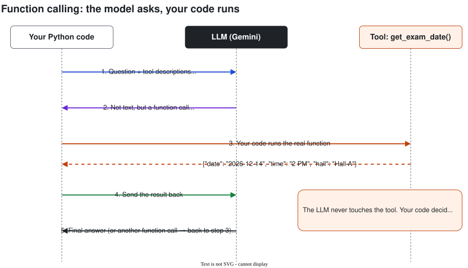
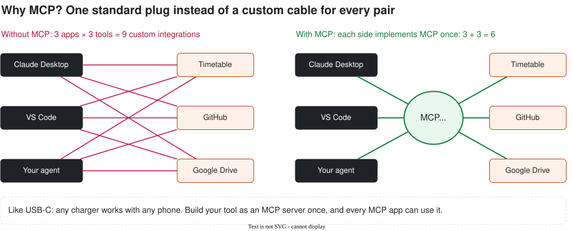
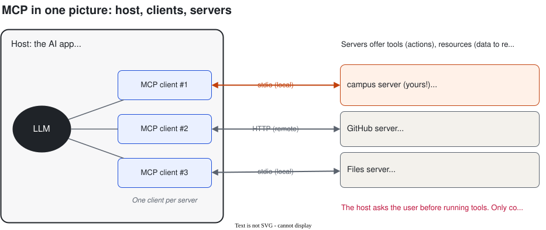

# Session 7: Tool Calling and MCP

**Day 2 · Session 7 · 1.5 hours** · [Slides](slides.html) · [Web version of these notes](notes.html) · [Lab notebook](../labs/session-07-tools-mcp-lab.ipynb)

In Session 6 you *played* the agent on paper. Now we build it for real: give Gemini tools, write the agent loop in Python, call a live weather API, and then package the same tools as an **MCP server** that any AI app can use.

## Contents

1. [Function calling, step by step](#1-function-calling-step-by-step)
2. [Writing a tool the model can use](#2-writing-a-tool-the-model-can-use)
3. [One round by hand](#3-one-round-by-hand)
4. [The agent loop in Python](#4-the-agent-loop-in-python)
5. [The shortcut: automatic function calling](#5-the-shortcut-automatic-function-calling)
6. [Calling a real API](#6-calling-a-real-api)
7. [Why MCP?](#7-why-mcp)
8. [How MCP works](#8-how-mcp-works)
9. [Build your own MCP server](#9-build-your-own-mcp-server)
10. [Use it from your agent and from real apps](#10-use-it-from-your-agent-and-from-real-apps)
11. [Staying safe with tools and MCP](#11-staying-safe-with-tools-and-mcp)
12. [Lab](#12-lab-timetable-agent--mcp-server-45-min)
13. [Recap, quiz and glossary](#13-recap)

---

## 1. Function calling, step by step

**Function calling** (or **tool calling**) is the API feature that makes agents possible. You tell the model which functions exist; when it needs one, it replies with a structured request instead of text.



1. You send the question **plus descriptions of your tools**.
2. The model replies with a **function call**: a name and arguments, like `get_exam_date(subject="OS")`.
3. **Your code** runs the real function.
4. You send the **result** back.
5. The model writes the answer, or asks for another function (back to step 3).

---

## 2. Writing a tool the model can use

A tool is a normal Python function:

```python
EXAMS = {
    "DBMS": {"subject": "DBMS", "date": "2026-12-12", "day": "Saturday", "time": "10 AM", "hall": "Hall B"},
    "OS":   {"subject": "OS",   "date": "2026-12-14", "day": "Monday",   "time": "2 PM",  "hall": "Hall A"},
    "CN":   {"subject": "CN",   "date": "2026-12-16", "day": "Wednesday", "time": "10 AM", "hall": "Hall C"},
}

def get_exam_date(subject: str) -> dict:
    """Get the date, day, time and hall of a student's semester exam. subject: DBMS, OS or CN."""
    exam = EXAMS.get(subject.strip().upper())
    if exam is None:
        return {"error": f"No exam found for '{subject}'. Known subjects: DBMS, OS, CN."}
    return exam

# Also: get_library_hours(date), book_study_room(date, start, hours), get_weather(city)
```

The model only sees a **declaration**:

```python
{
    "name": "get_exam_date",
    "description": "Get the date, day, time and hall of a student's semester exam.",
    "parameters": {
        "type": "object",
        "properties": {"subject": {"type": "string", "description": "Subject code: DBMS, OS or CN"}},
        "required": ["subject"],
    },
}
```

**Tips for good tools**
- **Clear name and description:** what it does *and when to use it*.
- **Describe every parameter**, including the format ("YYYY-MM-DD", "1 to 3").
- **Return structured data** (a dict), not a long sentence.
- **Return errors, don't crash**, so the model can explain or fix its mistake.
- **Small and focused:** one job per tool; separate read-only tools from actions.
- **Validate inputs** in code: the model may send `2.0` instead of `2`.

---

## 3. One round by hand

```python
config = types.GenerateContentConfig(
    system_instruction=SYSTEM,
    tools=[types.Tool(function_declarations=declarations)],
    temperature=0,
)

question = "When is my OS exam?"
resp = client.models.generate_content(model=MODEL, contents=question, config=config)
call = resp.function_calls[0]
print(call.name, dict(call.args))          # get_exam_date {'subject': 'OS'}

result = TOOLS[call.name](**call.args)      # WE run the tool

contents = [
    types.Content(role="user", parts=[types.Part(text=question)]),
    resp.candidates[0].content,             # the model's tool request
    types.Content(role="user", parts=[
        types.Part.from_function_response(name=call.name, response={"result": result}),
    ]),
]
final = client.models.generate_content(model=MODEL, contents=contents, config=config)
print(final.text)   # "Your OS exam is on Monday 14 Dec at 2 PM in Hall A."
```

---

## 4. The agent loop in Python

```python
NEEDS_APPROVAL = {"book_study_room"}

def run_agent(goal, max_steps=6, ask_human=True):
    contents = [types.Content(role="user", parts=[types.Part(text=goal)])]
    for step in range(1, max_steps + 1):                       # always cap the loop
        resp = client.models.generate_content(model=MODEL, contents=contents, config=config)
        if not resp.function_calls:                             # no tool needed: done
            return resp.text
        contents.append(resp.candidates[0].content)
        parts = []
        for call in resp.function_calls:                        # may be several at once!
            args = dict(call.args or {})
            print(f"🛠️  step {step}: {call.name}({args})")
            if call.name in NEEDS_APPROVAL and ask_human and input("Approve? (y/n) ") != "y":
                result = {"status": "cancelled", "reason": "The student did not approve this action."}
            else:
                result = TOOLS[call.name](**args)
            print(f"👀 {result}")
            parts.append(types.Part.from_function_response(name=call.name, response={"result": result}))
        contents.append(types.Content(role="user", parts=parts))
    return "Sorry, I couldn't finish that. Please contact the office."
```

What you'll see:

```text
🛠️  step 1: get_exam_date({'subject': 'OS'})
👀 {'subject': 'OS', 'date': '2026-12-14', 'day': 'Monday', 'time': '2 PM', 'hall': 'Hall A'}
🛠️  step 2: get_library_hours({'date': '2026-12-13'})
👀 {'date': '2026-12-13', 'day': 'Sunday', 'open': '10:00', 'close': '16:00', ...}
🛠️  step 3: book_study_room({'date': '2026-12-13', 'start': '10:00', 'hours': 2})
   Approve? (y/n) y
👀 {'status': 'confirmed', 'room': 'S1', ...}
```

**Parallel calls:** for "How many days between my first and last exam?", the model often asks for two `get_exam_date` calls in the same step. That's why the loop handles a list.

---

## 5. The shortcut: automatic function calling

Pass the **Python functions** themselves; the SDK reads docstrings and type hints and runs the loop:

```python
auto_config = types.GenerateContentConfig(
    system_instruction=SYSTEM,
    tools=[get_exam_date, get_library_hours, get_weather],   # plain Python functions
)
resp = client.models.generate_content(
    model=MODEL, contents="Is the library open on the day before my CN exam?", config=auto_config)
print(resp.text)
```

Great for quick scripts, but you lose control: no approval step, no per-call logging.

---

## 6. Calling a real API

`get_weather` uses [Open-Meteo](https://open-meteo.com): free, no API key.

```python
def get_weather(city: str) -> dict:
    """Get the current temperature and today's and tomorrow's rain chance for a city."""
    geo = requests.get("https://geocoding-api.open-meteo.com/v1/search",
                       params={"name": city, "count": 1}, timeout=10).json()
    if not geo.get("results"):
        return {"error": f"City '{city}' not found."}
    place = geo["results"][0]
    wx = requests.get("https://api.open-meteo.com/v1/forecast", params={
        "latitude": place["latitude"], "longitude": place["longitude"],
        "current": "temperature_2m",
        "daily": "precipitation_probability_max,temperature_2m_max,temperature_2m_min",
        "timezone": "auto", "forecast_days": 2}, timeout=10).json()
    ...   # pick out today's and tomorrow's numbers (full code in the lab)
```

*"Will it rain in Mysuru tomorrow? Should I carry an umbrella?"* now gets a real answer from live data.

---

## 7. Why MCP?

Without a standard, every AI app needs a custom integration for every tool.



The **Model Context Protocol (MCP)** is an open standard for connecting AI apps to tools and data. Anthropic introduced it in late 2024; OpenAI, Google, Microsoft and many others have adopted it, and there are thousands of ready-made servers (GitHub, Google Drive, Slack, databases, browsers...).

> **Analogy: USB-C.** Any USB-C charger works with any USB-C phone. Build your tool as an MCP server once, and every MCP app can plug it in.

---

## 8. How MCP works



| Part | What it is | Example |
| --- | --- | --- |
| **Host** | The AI app the user talks to | Claude Desktop, VS Code, Cursor, your own agent |
| **Client** | Inside the host; one connection per server | The `ClientSession` in our lab |
| **Server** | A small program that offers capabilities | Our `campus_server.py` |
| **Transport** | How they talk | **stdio** (local process) or **HTTP** (remote) |

Servers offer **tools** (actions), **resources** (data to read) and **prompts** (templates).

---

## 9. Build your own MCP server

With the official Python SDK (`pip install mcp`):

```python
# campus_server.py
from mcp.server.mcpserver import MCPServer
from campus_tools import get_exam_date, get_library_hours, book_study_room, get_weather

mcp = MCPServer("campus")

for fn in (get_exam_date, get_library_hours, book_study_room, get_weather):
    mcp.add_tool(fn)     # name, docstring and type hints become the tool's description

if __name__ == "__main__":
    mcp.run()            # stdio transport
```

> **Heads-up: SDK versions.** This is version 2 of the MCP Python SDK. Most older tutorials use version 1: `from mcp.server.fastmcp import FastMCP` and `mcp = FastMCP("campus")`. Same idea, new name. If you see *"No module named 'mcp.server.fastmcp'"*, that's why.

---

## 10. Use it from your agent and from real apps

### From Python (an MCP client)

```python
from mcp import ClientSession, StdioServerParameters
from mcp.client.stdio import stdio_client

server = StdioServerParameters(command=sys.executable, args=["campus_server.py"])

async with stdio_client(server) as (read, write):
    async with ClientSession(read, write) as session:
        await session.initialize()
        tools = await session.list_tools()                         # discover tools
        result = await session.call_tool("get_exam_date", {"subject": "OS"})
        print(result.content[0].text)
```

In the lab, we feed the discovered tools to Gemini and send every call through `session.call_tool`.

### From Claude Desktop, Claude Code, VS Code or Cursor

Claude Desktop (Settings → Developer → Edit Config):

```json
{
  "mcpServers": {
    "campus": {
      "command": "python",
      "args": ["C:/path/to/campus_server.py"]
    }
  }
}
```

Claude Code: `claude mcp add campus -- python /path/to/campus_server.py`. VS Code and Cursor have similar MCP settings.

---

## 11. Staying safe with tools and MCP

- **Least privilege:** read-only tools by default. A booking tool, not "run any SQL".
- **Human approval** for actions that change things or can't be undone.
- **Validate arguments** in the tool, not just in the prompt.
- **Cap the loop** and log every call.
- **Only install MCP servers you trust.** A local server runs code on your machine, and tool descriptions can hide instructions (prompt injection).
- **Never put secrets in tool results** or descriptions.

---

## 12. Lab: timetable agent + MCP server (45 min)

[](https://colab.research.google.com/github/Amitpnk/Agentic-AI-From-Zero/blob/main/labs/session-07-tools-mcp-lab.ipynb)

**Part A: function calling**
1. Write and test the four tools (timetable, library hours, booking, live weather).
2. Describe them to Gemini.
3. Do one round by hand and see the function call.
4. Write the agent loop with an approval step. Run the Session 6 goal cards for real.
5. Try the automatic shortcut.

**Part B: MCP**
6. Turn the same tools into an MCP server.
7. Connect to it as an MCP client: list and call tools.
8. Give Gemini its tools from the MCP server.
9. On your laptop: plug the server into Claude Desktop, Claude Code or VS Code.

**Stretch:** add `search_faq` from Session 4 as a tool · improve an error message so the model fixes its own mistake · serve over HTTP · add a fake `send_email_to_all_students` tool and try a prompt injection.

This is **[Project 4](../projects/README.md#project-4--timetable-agent--mcp-server)** in the workshop project list.

---

## 13. Recap

1. **Function calling:** the model replies with a tool name + arguments; your code runs it and sends the result back.
2. The model only sees the **declaration**. Write it carefully.
3. Tools return structured data and **errors instead of crashing**.
4. The **agent loop** = function calling in a capped loop, with approval for risky actions.
5. **MCP** is the USB-C of AI tools: build a server once, use it from any MCP app.
6. Host → client → server; tools, resources, prompts; stdio or HTTP.
7. Only connect servers you trust.

## Quick quiz

<details><summary>1. When the model wants a tool, what does it send back?</summary>A function call: the tool's name and arguments, not text and not the result.</details>
<details><summary>2. Why return <code>{"error": ...}</code> instead of raising an exception?</summary>So the model can explain the problem or retry with better arguments.</details>
<details><summary>3. Downside of automatic function calling?</summary>Less control: no easy approval step, logging or extra checks.</details>
<details><summary>4. What problem does MCP solve?</summary>apps × tools custom integrations. With MCP, each side implements the protocol once.</details>
<details><summary>5. The three MCP roles?</summary>Host, client, server.</details>
<details><summary>6. stdio vs HTTP transport?</summary>stdio: local process. HTTP: a server running somewhere else.</details>
<details><summary>7. A random "free unlimited tools" MCP server: any risk?</summary>Yes: it runs code on your machine and can hide instructions in tool descriptions.</details>

## Glossary

| Term | Meaning in one line |
| --- | --- |
| Function / tool calling | The model asks your code to run a named function with arguments. |
| Function declaration | Name, description and parameter schema the model sees. |
| JSON Schema | A standard way to describe the shape of JSON data. |
| Function response | The tool's result, sent back to the model. |
| Parallel function calls | Several tool calls in one step. |
| Automatic function calling | The SDK runs the tool loop for you. |
| MCP | Model Context Protocol: open standard connecting AI apps to tools and data. |
| MCP host / client / server | The AI app / its connection to a server / the program offering tools. |
| Resource (MCP) | Data a server exposes for reading. |
| Transport | How client and server talk: stdio or HTTP. |

## Learn more (free)

- Google, *Function calling with the Gemini API* (ai.google.dev)
- Model Context Protocol docs (modelcontextprotocol.io)
- MCP Python SDK on GitHub (modelcontextprotocol/python-sdk), including the v1 → v2 migration guide
- Open-Meteo API docs (open-meteo.com)

## Instructor guide

| Time | Segment | What to do |
| --- | --- | --- |
| 0–5 min | Hook | "Yesterday you were the Tools person. Today Python is." |
| 5–15 min | Function calling | Sequence diagram. Step 2 returns a request, not an answer. |
| 15–25 min | Tools + declarations | `get_exam_date` and its declaration. Tips. |
| 25–40 min | Live: one round + the loop | Lab Steps 3–4 on the projector; read 🛠️/👀 as Think/Act/Observe. |
| 40–50 min | MCP | Why-MCP diagram, USB-C, host/client/server, the 10-line server. |
| 50–85 min | Lab | Parts A and B. Fast students: Claude Desktop or VS Code on their laptop. |
| 85–90 min | Recap + quiz | Quiz 1, 4, 7. Preview Session 8. |

**Before class:** run the notebook once on Colab; check `MODEL` and the `mcp` version (written for v2). Function calling makes several requests per question, so rate limits hit sooner: stagger the class or keep a backup key.

*Diagram sources: [function-calling.drawio](diagrams/function-calling.drawio) · [why-mcp.drawio](diagrams/why-mcp.drawio) · [mcp-architecture.drawio](diagrams/mcp-architecture.drawio)*

---

**Previous:** [Session 6: From Chatbots to Agents](../session-06/notes.md) · **Next:** [Session 8: Agent Frameworks and Multi-Agent Systems](../session-08/notes.md)
