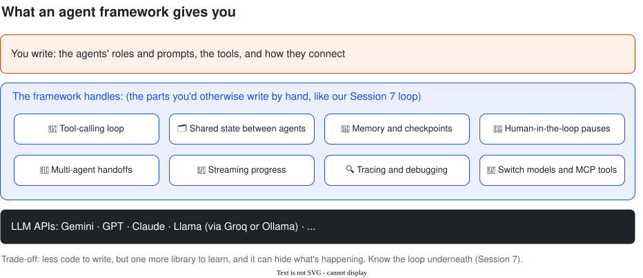
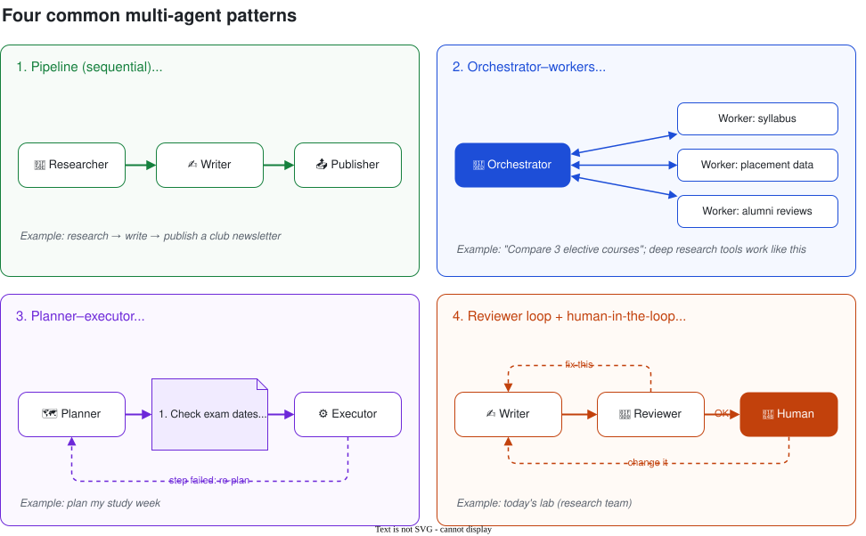
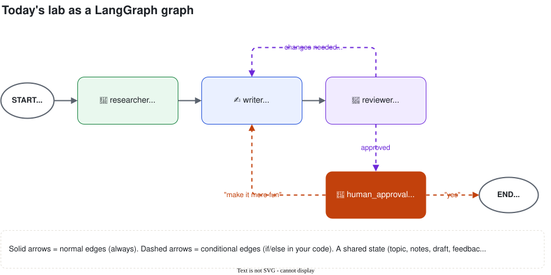

# Session 8: Agent Frameworks and Multi-Agent Systems

**Day 2 · Session 8 · 1.5 hours** · [Slides](slides.html) · [Web version of these notes](notes.html) · [Lab notebook](../labs/session-08-multi-agent-lab.ipynb)

In Session 7 you wrote the agent loop by hand. Real projects also need shared state, retries, pauses for human approval, and sometimes a **team** of agents. Frameworks give you those building blocks. Today you'll compare the popular ones and build a researcher + writer team.

## Contents

1. [Why use a framework?](#1-why-use-a-framework)
2. [LangGraph, CrewAI and the agent SDKs compared](#2-langgraph-crewai-and-the-agent-sdks-compared)
3. [Why more than one agent?](#3-why-more-than-one-agent)
4. [Four multi-agent patterns](#4-four-multi-agent-patterns)
5. [Human-in-the-loop](#5-human-in-the-loop)
6. [When not to use multiple agents](#6-when-not-to-use-multiple-agents)
7. [LangGraph in 10 minutes](#7-langgraph-in-10-minutes)
8. [The same team in CrewAI](#8-the-same-team-in-crewai-for-comparison)
9. [Lab](#9-lab-a-research-team-of-agents-40-min)
10. [Recap, quiz and glossary](#10-recap)

---

## 1. Why use a framework?

A real app quickly needs more than the Session 7 loop: remember state, pause for a human and resume tomorrow, retry failed tools, show progress, log everything, coordinate several agents. A **framework** gives you tested building blocks so you focus on the agents.



> **Learn the loop first, then the framework.** Frameworks change fast and can hide what's going on. Because you built the loop by hand, you can debug any framework when it misbehaves.

---

## 2. LangGraph, CrewAI and the agent SDKs compared

| Framework | How you think about it | Strengths | Good for |
| --- | --- | --- | --- |
| **LangGraph** (LangChain) | A **graph**: nodes connected by edges, with shared state | Fine control, loops, pause/resume, human-in-the-loop, any model | Production agents needing control |
| **CrewAI** | A **crew** of role-playing agents (role, goal, backstory) doing tasks | Very quick to start, readable | Prototypes, content and research teams |
| **OpenAI Agents SDK** | Lightweight **agents + handoffs**, with guardrails | Simple, built-in tracing; best with OpenAI models | Simple multi-agent apps, triage |
| **Claude Agent SDK** | The **agent harness behind Claude Code**: tools, files, shell, MCP, subagents | Strong general-purpose agents | Agents working with files, code, automation |
| **Google ADK** | Agents and multi-agent systems, Gemini-first | Gemini integration, evaluation, Google Cloud deploy | Gemini / Google Cloud projects |
| **Microsoft Agent Framework** | Successor to AutoGen and Semantic Kernel | Multi-agent conversations, Azure, .NET and Python | Azure and .NET teams |

All share the same core: an LLM, tools (often via MCP), a loop, memory and coordination. Pick by **model**, **cloud** and how much **control** you need. The lab uses **LangGraph**.

This space moves very fast. Always check the official docs for the version you install.

---

## 3. Why more than one agent?

One agent with 20 tools and a giant prompt gets confused. Split the job into **specialists**, like separate teams for a college fest.

- **Focus:** short, clear prompts; only the tools each needs.
- **Quality checks:** one agent reviews another.
- **Parallel work:** several agents research at once.
- **Smaller context:** each sees only what it needs.

**Today's team:** 🔎 Researcher (Wikipedia tool) → ✍️ Writer → 🧐 Reviewer → 🙋 You (final approval).

---

## 4. Four multi-agent patterns



| Pattern | How it works | Use it when |
| --- | --- | --- |
| **Pipeline** | Each agent does one step and passes it on | Clear steps, same order every time |
| **Orchestrator–workers** | Lead agent splits the task, workers run in parallel, lead combines | Task splits into independent parts |
| **Planner–executor** | One agent plans, another executes, re-plan on failure | Long multi-step tasks |
| **Reviewer loop** (evaluator–optimizer) | A critic sends work back with feedback until it's good | Quality matters and can be checked |

Real systems mix these: "deep research" tools use an orchestrator with parallel research workers, then a writer and a citation checker.

---

## 5. Human-in-the-loop

**HITL** = the agent pauses at important moments and waits for a person.

| Kind | Example |
| --- | --- |
| Approve or reject an action | "Book room S3 on Sunday 10–12?" |
| Edit the output | Fix the article's title before publishing |
| Give feedback | "Make it more fun" → back to the writer |
| Review the plan first | Check 5 steps before anything runs |
| Answer a question | "3rd- or 5th-semester syllabus?" |

In LangGraph a node calls `interrupt(...)` to pause; a **checkpointer** saves the state; `Command(resume=...)` continues, even days later.

---

## 6. When not to use multiple agents

- **Cost:** Anthropic reported its multi-agent research system used about **15 times** more tokens than a normal chat.
- **Coordination errors:** agents misunderstand each other, repeat work, pass mistakes on.
- **Harder to debug and test.**
- **Tightly linked steps** work better in one agent.

> **A good rule:** start with **one agent** with good tools. Split only when you can name the specialists and explain why each needs its own prompt, tools or context.

---

## 7. LangGraph in 10 minutes



| Idea | What it is | In code |
| --- | --- | --- |
| **State** | Shared data every node reads and updates | `class TeamState(TypedDict): topic, notes, draft, feedback, approved, revisions` |
| **Node** | A function: takes state, returns updates | `graph.add_node("writer", writer)` |
| **Edge** | Always go from A to B | `graph.add_edge("researcher", "writer")` |
| **Conditional edge** | Your function decides what's next | `graph.add_conditional_edges("reviewer", after_review, [...])` |
| **Checkpointer** | Saves state after every step | `graph.compile(checkpointer=InMemorySaver())` |
| **Interrupt** | Pause and wait for a human | `answer = interrupt({"draft": ...})` |

```python
def after_review(state):
    if state["approved"] or state["revisions"] >= MAX_REVISIONS:
        return "human_approval"
    return "writer"                         # loop back with the reviewer's feedback

def human_approval(state):
    answer = interrupt({"draft": state["draft"], "question": "Type 'yes' to publish, or what to change:"})
    if answer.strip().lower() in ("yes", "y"):
        return {"approved": True, "feedback": ""}
    return {"approved": False, "feedback": f"Editor-in-chief says: {answer}"}

graph = StateGraph(TeamState)
graph.add_node("researcher", researcher)
graph.add_node("writer", writer)
graph.add_node("reviewer", reviewer)
graph.add_node("human_approval", human_approval)
graph.add_edge(START, "researcher")
graph.add_edge("researcher", "writer")
graph.add_edge("writer", "reviewer")
graph.add_conditional_edges("reviewer", after_review, ["writer", "human_approval"])
graph.add_conditional_edges("human_approval", lambda s: END if s["approved"] else "writer", ["writer", END])

app = graph.compile(checkpointer=InMemorySaver())
```

The reviewer uses **structured output** so the graph can branch on a real `True`/`False`:

```python
class Review(BaseModel):
    approved: bool
    feedback: str

def reviewer(state):
    review = llm.with_structured_output(Review).invoke([
        SystemMessage(REVIEWER_PROMPT),
        HumanMessage(f"Research notes:\n{state['notes']}\n\nDraft:\n{state['draft']}"),
    ])
    return {"approved": review.approved, "feedback": review.feedback}
```

---

## 8. The same team in CrewAI (for comparison)

A sketch to compare styles (not part of the lab; check the CrewAI docs for the current API):

```python
from crewai import Agent, Task, Crew, Process

researcher = Agent(role="Researcher", goal="Find accurate facts about {topic}",
                   backstory="A careful fact-finder for a college magazine.",
                   llm="gemini/gemini-2.5-flash")
writer = Agent(role="Writer", goal="Write a 200-word article for first-year students",
               backstory="A friendly tech-magazine writer.",
               llm="gemini/gemini-2.5-flash")

research = Task(description="Research {topic}. List 6-10 key facts with sources.",
                expected_output="Bullet-point notes with URLs", agent=researcher)
write = Task(description="Write the article using the research notes.",
             expected_output="A ~200-word article with a Sources list", agent=writer, context=[research])

crew = Crew(agents=[researcher, writer], tasks=[research, write], process=Process.sequential)
print(crew.kickoff(inputs={"topic": "Chandrayaan-3"}))
```

Shorter and readable. LangGraph takes more code but gives explicit loops, branches, pauses and state.

---

## 9. Lab: a research team of agents (40 min)

[](https://colab.research.google.com/github/Amitpnk/Agentic-AI-From-Zero/blob/main/labs/session-08-multi-agent-lab.ipynb)

1. Build a real `search_wikipedia` tool (free, no key).
2. Write three agents as plain functions: researcher (with the tool), writer, reviewer (structured output).
3. Run them as a simple Python pipeline.
4. Wire the *same* functions into a LangGraph graph with a review loop and a human-approval pause.
5. Run it as the editor-in-chief: ask for changes, then approve.
6. Look inside the saved state and history.

> **If Wikipedia says "busy":** it limits requests per network, and a whole class on one Wi-Fi can hit that. The tool waits and retries, and has backup facts for the example topic (Chandrayaan-3).

**Stretch:** your own topic · a fact-checker agent · two researchers in parallel (orchestrator–workers) · swap Wikipedia for your Session 4 or Session 7 tools · count the LLM calls per article.

This is **[Project 5](../projects/README.md#project-5--research-team-multi-agent)** in the workshop project list.

---

## 10. Recap

1. Frameworks give you the loop, state, memory, pauses, tracing and multi-agent wiring.
2. **LangGraph** = control; **CrewAI** = quick crews; **agent SDKs** = lighter, model-specific.
3. Multiple agents help with **focus**, **quality checks** and **parallel work**.
4. Patterns: **pipeline**, **orchestrator–workers**, **planner–executor**, **reviewer loop**.
5. **Human-in-the-loop**: pause, approve/edit/feedback, resume.
6. Multi-agent costs many more tokens. Start with one agent.

## Quick quiz

<details><summary>1. Three things a framework gives you?</summary>Tool-calling loop, shared state, memory/checkpoints, HITL pauses, handoffs, streaming, tracing, model switching (any three).</details>
<details><summary>2. LangGraph vs CrewAI in one line each?</summary>LangGraph: graph of nodes and edges with explicit state and control. CrewAI: crew of role-playing agents doing tasks.</details>
<details><summary>3. Which pattern fits "compare 5 companies for placements"?</summary>Orchestrator–workers.</details>
<details><summary>4. What does a reviewer agent add?</summary>A quality check with feedback until the work is good.</details>
<details><summary>5. How does LangGraph pause for a human and resume later?</summary><code>interrupt()</code> + a checkpointer; then <code>Command(resume=...)</code>.</details>
<details><summary>6. Two reasons not to use multiple agents?</summary>Cost (tokens), coordination errors, harder debugging, tightly linked steps.</details>
<details><summary>7. Why does the reviewer use structured output?</summary>So the graph gets a real <code>approved: True/False</code> to branch on.</details>

## Glossary

| Term | Meaning in one line |
| --- | --- |
| Agent framework | Building blocks for agents: loop, state, tools, memory, coordination. |
| Multi-agent system | Several agents with different roles working on one task. |
| Orchestrator | A lead agent that splits work and combines results. |
| Worker / subagent | An agent handling one part of a bigger task. |
| Handoff | One agent passing the task to another. |
| Planner–executor | One agent plans, another carries it out. |
| Evaluator / critic | An agent that checks another's work. |
| Human-in-the-loop | The agent pauses for a person to approve, edit or give feedback. |
| State | The shared data passed between nodes. |
| Node / edge | A step in the graph / a connection deciding what runs next. |
| Checkpointer | Saves state after each step: pause, resume, replay. |
| Interrupt | LangGraph's way to pause and wait for input. |

## Learn more (free)

- LangChain Academy, *Introduction to LangGraph*
- Anthropic, *How we built our multi-agent research system*
- Anthropic, *Building effective agents*
- Official docs: CrewAI, OpenAI Agents SDK, Claude Agent SDK, Google ADK

## Instructor guide

| Time | Segment | What to do |
| --- | --- | --- |
| 0–5 min | Hook | Session 7 loop: what if it must pause until tomorrow, or be three agents? |
| 5–18 min | Frameworks | Stack diagram; comparison table by "how you think about it". |
| 18–33 min | Multi-agent + patterns | College-fest teams; class matches patterns to campus examples. |
| 33–40 min | HITL + when not | HITL table; 15× tokens; "start with one agent". |
| 40–48 min | LangGraph basics | Lab graph, then state, nodes, edges, conditional edges, interrupt. |
| 48–85 min | Lab | Steps 1–6; share the funniest editor feedback. |
| 85–90 min | Recap + quiz | Quiz 3, 5, 6. Preview Session 9. |

**Before class:** run the notebook once on Colab; check `MODEL` and package versions (LangGraph 1.x). One article takes about 6–10 LLM calls, so stagger the class or keep a backup key. Backup facts keep the default topic working if Wikipedia rate-limits the campus Wi-Fi.

*Diagram sources: [framework-stack.drawio](diagrams/framework-stack.drawio) · [multi-agent-patterns.drawio](diagrams/multi-agent-patterns.drawio) · [research-team-graph.drawio](diagrams/research-team-graph.drawio)*

---

**Previous:** [Session 7: Tool Calling and MCP](../session-07/notes.md) · **Next:** [Session 9: Taking Agents to Production](../session-09/notes.md)
