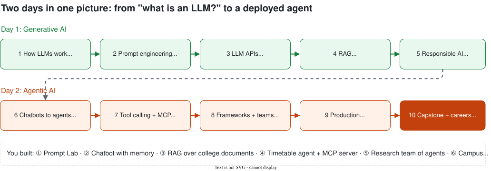
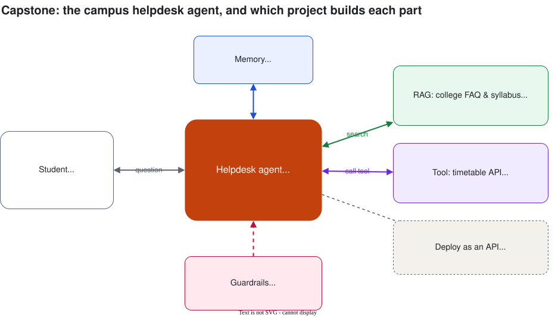
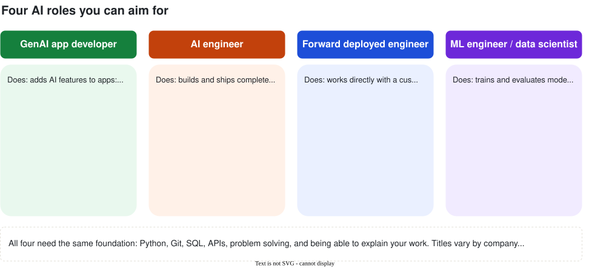
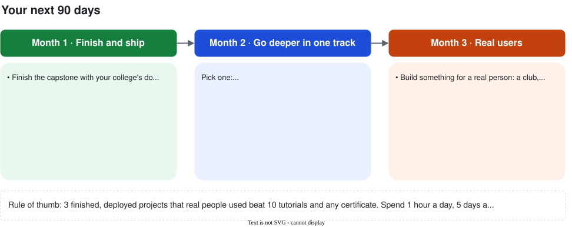

# Session 10: Mini Project and Careers

**Day 2 · Session 10 · 1 hour** · [Slides](slides.html) · [Web version of these notes](notes.html) · [Capstone notebook](../labs/session-10-capstone-lab.ipynb)

Time to put it all together. First you'll build the campus helpdesk agent, using everything from the two days in one notebook. Then: the jobs, what to learn next, and how to build a portfolio that gets interviews.

[](https://colab.research.google.com/github/Amitpnk/Agentic-AI-From-Zero/blob/main/labs/session-10-capstone-lab.ipynb)

## Contents

1. [Two days in one picture](#1-two-days-in-one-picture)
2. [The capstone: campus helpdesk agent](#2-the-capstone-campus-helpdesk-agent)
3. [AI careers: the roles](#3-ai-careers-the-roles)
4. [What companies look for](#4-what-companies-look-for)
5. [Your next 90 days](#5-your-next-90-days)
6. [A portfolio that gets interviews](#6-a-portfolio-that-gets-interviews)
7. [Interview questions you can now answer](#7-interview-questions-you-can-now-answer)
8. [Free resources](#8-free-resources)
9. [Two-day review quiz](#9-two-day-review-quiz)

---

## 1. Two days in one picture



Two days ago, an LLM was something you chatted with. Now you know how it works, how to prompt it, call it from code, ground it in your documents, keep it safe, give it tools, organise agents into teams, and ship it. That's the core skill set of an AI engineer.

---

## 2. The capstone: campus helpdesk agent

A student asks: *"When is my OS exam? Is the library open the day before? And what's the late fee if I pay my fees late?"* Your agent answers all three, with the right tool for each, and remembers who it's talking to.



| Piece | What it does | From |
| --- | --- | --- |
| System prompt | Role, rules, "cite sources", "never guess" | Session 2 |
| Memory | Remembers the conversation (questions and answers only) | Session 3 |
| `search_faq` tool | RAG over the college FAQ, as a tool the agent chooses | Session 4 |
| Guardrails | Injection check and personal-data masking | Session 5 |
| Agent loop | The model picks tools until it can answer | Sessions 6–7 |
| Live tools | Exam timetable, library hours, weather (read-only) | Session 7 |
| Evals | 6 test cases before you share it | Session 9 |
| Chat web page | Gradio: a shareable link for your phone | New today |

### The key new idea: RAG as a tool

In Session 4 the bot *always* searched the FAQ. Now `search_faq` is one of the agent's tools, and the agent decides when to use it.

```python
def search_faq(question: str) -> dict:
    """Search the college FAQ (rules about exams, attendance, fees, hostel, library, placements...)."""
    q = embedder.encode([question], normalize_embeddings=True).tolist()
    res = col.query(query_embeddings=q, n_results=3)
    hits = [{"source": m["source"], "text": t, "score": round(1 - d / 2, 2)}
            for t, m, d in zip(res["documents"][0], res["metadatas"][0], res["distances"][0])]
    hits = [h for h in hits if h["score"] >= MIN_SCORE]
    return {"results": hits} if hits else {"results": [], "note": "Nothing relevant in the FAQ."}

TOOLS = {f.__name__: f for f in (search_faq, get_exam_date, get_library_hours, get_weather)}
```

### A conversation with your agent

```text
🧑 Hi, I'm Priya from CSE, 3rd year.
🤖 Hi Priya! How can I help?
🧑 When is my OS exam?
   🛠️  get_exam_date({'subject': 'OS'})
🤖 Your OS exam is on Monday 14 December at 2 PM in Hall A.
🧑 Is the library open the day before? I want to study there.
   🛠️  get_library_hours({'date': '2026-12-13'})
🤖 Yes! Sunday 13 December is in exam month, so it's open 10 AM to 4 PM.
🧑 What's the late fee if I pay my second fee instalment late?
   🛠️  search_faq({'question': 'late fee second instalment'})
🤖 ₹100 per day after 15 January, up to ₹2,000 [Fees].
🧑 Thanks! By the way, what's my name and branch?
🤖 You're Priya, from CSE.
```

"The day before" only works because of **memory**: the agent remembered the exam date from the previous turn.

### Lab steps (30 min)

1. Build the knowledge base: chunk, embed and store the FAQ.
2. Set up the four read-only tools, including `search_faq`.
3. Write the system prompt and guardrails.
4. Build `chat()`: guardrails → memory → agent loop → output check.
5. Have the five-turn conversation.
6. Run the evals.
7. Launch the Gradio chat page and open it on your phone.

**Make it yours:** your college's real documents · a new tool (bus timings, canteen menu, lab slots) · Hindi or Kannada · deploy it with the [Session 9 starter](../labs/session-09-deploy/) · room booking with human approval.

This is **[Project 6](../projects/README.md#project-6--campus-helpdesk-agent-capstone)**, the capstone.

---

## 3. AI careers: the roles



| Role | A typical day | You'd enjoy it if... |
| --- | --- | --- |
| **GenAI app developer** | Add a "chat with your documents" feature; tune prompts; connect a vector DB | You like building features people use |
| **AI engineer** | Build an agent with tools, write evals, read traces to find wrong answers, cut cost per request | You like engineering, debugging, reliability |
| **Forward deployed engineer** | Sit with a bank's or hospital's team, understand their messy problem, prototype in days, get it into their systems | You like people, variety and direct impact |
| **ML engineer / data scientist** | Prepare data, train or fine-tune, run experiments, deploy and monitor models | You like maths, data and experiments |

Related: **MLOps / LLMOps engineer**, **AI product manager**, **solutions architect**, **AI safety / red-team** roles. "Prompt engineer" is now usually a skill inside these jobs.

> **Remember Session 1:** AI replaces *tasks*, not whole jobs. These roles exist because companies need people who turn AI into something that works for their customers, safely and at a sensible cost.

---

## 4. What companies look for

| Skill | How to show it |
| --- | --- |
| **Fundamentals**: Python, Git, SQL, APIs, DSA | Clean code on GitHub; coding rounds |
| **Building with LLMs**: prompts, RAG, tools, agents | Deployed projects (like your capstone) |
| **Judgement**: RAG vs agent vs workflow; when *not* to use AI | Design choices in your README and interviews |
| **Quality**: evals, testing, debugging with traces | An eval set and results in your repo |
| **Responsibility**: safety, privacy, cost | Guardrails and a "limitations" section |
| **Communication** | A blog or LinkedIn post about what you built |

---

## 5. Your next 90 days



Pick a track by what excited you most: answering from documents (RAG), tools and agents, or how models learn (ML). Depth in one beats a little of everything.

---

## 6. A portfolio that gets interviews

1. **Three good projects beat ten tutorials.** Your capstone is the first.
2. **Solve a real problem for a real person**, even a small one.
3. **A README that sells it:** summary, screenshot or GIF, architecture diagram, how to run, example questions, eval results, limitations.
4. **A live link** (Gradio, Hugging Face Spaces, Render, Cloud Run).
5. **Show your thinking:** "I used RAG instead of fine-tuning because..."
6. **No secrets in the repo.** Check twice for API keys.

> **Example README opening:** **CampusBuddy: an AI helpdesk for ABC Engineering College.** Answers questions about exams, fees, hostel and placements from the official FAQ (with sources), and checks live exam dates and library hours. Built with Gemini, Chroma and a hand-written agent loop. 92% on a 25-question eval set. *Try it: [your live link]*

---

## 7. Interview questions you can now answer

<details><summary>"How does an LLM generate text?"</summary>It predicts the next token from the tokens so far, again and again; temperature controls how adventurous the choice is. Session 1.</details>
<details><summary>"How would you reduce hallucination?"</summary>RAG with citations, allow "I don't know", lower temperature, tools for facts, evals, human review for important answers. Sessions 1, 4, 5.</details>
<details><summary>"Explain RAG. When would you use it instead of fine-tuning?"</summary>Retrieve chunks, add to the prompt, answer with citations. Use it when knowledge is private or changes often; fine-tuning changes style/behaviour, is costly and goes stale. Session 4.</details>
<details><summary>"Your RAG bot gives wrong answers. How do you debug it?"</summary>Check the retrieved chunks first; then extraction, chunk size, k, threshold, hybrid search; measure the hit rate. Session 4.</details>
<details><summary>"What is an AI agent? When would you not use one?"</summary>An LLM choosing and calling tools in a loop towards a goal. Not when a single call, RAG or a fixed workflow works. Session 6.</details>
<details><summary>"How does function calling work?"</summary>Send declarations; the model returns a name + arguments; your code runs it and sends the result back; repeat. Session 7.</details>
<details><summary>"What is MCP and why does it matter?"</summary>An open standard to connect AI apps to tools and data: build a server once, use it in any MCP app. Session 7.</details>
<details><summary>"How do you evaluate and monitor an LLM app in production?"</summary>An eval set run on every change and in CI; traces; dashboards for latency, errors, cost, feedback; alerts. Session 9.</details>
<details><summary>"How would you protect an agent from prompt injection?"</summary>Separate data from instructions, least privilege, human approval, input/output checks, no secrets in prompts, logging. Sessions 5, 9.</details>
<details><summary>"Design a chatbot for 10,000 college students."</summary>RAG over official documents + read-only live tools, behind an API with login and rate limits; small model, caching; evals in CI; tracing and dashboards; pilot first. Sessions 4–9.</details>

---

## 8. Free resources

| Track | Where to learn (free) |
| --- | --- |
| LLM apps, RAG, agents | DeepLearning.AI short courses · Hugging Face LLM Course and Agents Course · Anthropic's courses on GitHub (anthropics/courses) · LangChain Academy |
| ML and deep learning | fast.ai *Practical Deep Learning for Coders* · Google *Machine Learning Crash Course* · NPTEL ML courses · Kaggle Learn |
| Practice and community | Kaggle competitions · Smart India Hackathon · Google Summer of Code · open-source AI projects |
| Staying current | Official blogs and docs of model providers; pick 2–3 and read weekly |

Certificates (for example cloud AI certifications from AWS, Microsoft or Google) can help, especially for services companies, but a deployed project you can demo and explain is worth more in almost every interview.

---

## 9. Two-day review quiz

<details><summary>1. Why does a chatbot "forget" the start of a long conversation? (Session 1)</summary>The context window filled up; old messages were dropped or summarised.</details>
<details><summary>2. Name the six parts of a good prompt. (Session 2)</summary>Role, Task, Context, Examples, Format, Rules.</details>
<details><summary>3. How does a chatbot remember your name? (Session 3)</summary>The app re-sends the history with every request.</details>
<details><summary>4. What do you check first when a RAG answer is wrong? (Session 4)</summary>The retrieved chunks.</details>
<details><summary>5. Direct vs indirect prompt injection? (Session 5)</summary>User types it vs hidden in content the bot reads.</details>
<details><summary>6. Workflow vs agent: who decides the next step? (Session 6)</summary>Your code vs the LLM.</details>
<details><summary>7. Who runs a tool? (Session 7)</summary>Your code; the model only asks.</details>
<details><summary>8. Two multi-agent patterns? (Session 8)</summary>Pipeline, orchestrator–workers, planner–executor, reviewer loop (any two).</details>
<details><summary>9. When do you run your eval set? (Session 9)</summary>After every change, and in CI before deploying.</details>
<details><summary>10. Why is RAG a tool in the capstone? (Session 10)</summary>So the agent decides when to search, instead of always searching.</details>

> **Thank you!** You started with "what is an LLM?" and finished with a working, tested AI agent. Ship the capstone this month, share it, and help a friend build theirs.

## Instructor guide

| Time | Segment | What to do |
| --- | --- | --- |
| 0–5 min | Two days in one picture | Journey diagram; one thing from each session. |
| 5–10 min | Capstone intro | Architecture; "RAG as a tool"; the five-turn conversation. |
| 10–35 min | Capstone lab | Pairs run the notebook through the Gradio link. |
| 35–40 min | Demos | 2–3 pairs demo on the projector or a phone. |
| 40–52 min | Careers | Roles, skills, 90-day roadmap, portfolio. |
| 52–57 min | Interview questions | Ask 3–4 aloud. |
| 57–60 min | Close | Repo link, feedback, certificates if provided. |

**Before class:** run the capstone once on Colab end to end, including the Gradio link. It makes several API calls per question, so have backup keys ready. Prepare the repo link or a QR code for the last slide.

*Diagram sources: [two-day-journey.drawio](diagrams/two-day-journey.drawio) · [ai-roles.drawio](diagrams/ai-roles.drawio) · [learning-roadmap.drawio](diagrams/learning-roadmap.drawio) · [helpdesk-architecture.drawio](../projects/diagrams/helpdesk-architecture.drawio)*

---

**Previous:** [Session 9: Taking Agents to Production](../session-09/notes.md) · [All sessions](../README.md)
